# Driving reliability continuation

The goal is a vision model that finishes cone tracks and full R,R,L,L skidpads without physical cone contacts in realistic Isaac scenes. No new checkpoint is promoted. The inherited failed trials and videos remain in [the correction report](../pi-correction-2026-11-10/README.md).

[The final acceptance suite](acceptance_suite.json) was frozen before new training or final checkpoint selection. It contains 16 held-out conditions and four candidate runs per condition. Every candidate run must finish with zero physical contacts and zero off-course events. Repeated realizations are reported separately from independent scene coverage. No final condition has been launched by this continuation.

## Execution diagnosis

[The reproducible divergence analysis](native_divergence_analysis/analyze.py) verifies eight original input hashes and the exact recorded teacher replay. The first follower command differs at tick 255 despite identical pose. At contact interval 449, OP plus PI is 0.29468 m laterally from the source path. Nearby spatial projection leaves 0.29479 m error, so this is more than fixed-clock phase lag. The velocity-displacement accounting is descriptive, not a causal decomposition.

The following are single-source privileged native diagnostics. They do not use a vision model to choose the executed path. The suffix arms retain teacher controls through tick254.

| Execution | Contact count | Off-course events | Simulated seconds | Full route and stop gate |
|---|---:|---:|---:|---|
| Inherited recorded teacher | 0 | 0 | 46.35 | Pass |
| Inherited OP plus PI suffix | 1 | 0 | 46.20 | Fail contact gate |
| OP plus position feedback, unchanged PI suffix | 0 | 0 | 46.15 | Pass |
| Unchanged OP, recorded longitudinal suffix | 0 | 0 | 46.35 | Pass |
| Position feedback and recorded longitudinal suffix | 0 | 0 | 46.35 | Pass |
| Unchanged OP plus PI from standing | 6 | 0 | 46.10 | Fail contact gate |

[The frozen suffix protocol and traces](native_transition_correction/) separate position restoration from longitudinal intervention. Both isolated interventions clear the contact on this source. They do not uniquely identify an underlying cause. The [standing-start run](native_standing_reference/) shows that a legitimate zero-integral start also contacts cones. The cold handoff is not a sufficient explanation of the execution gap.

The successful position correction reads source-minus-actual displacement at the initial plan knot. Neural targets start that knot at zero. Applying that correction directly to the neural output would not supply the privileged cross-track error.

[The independent command audit](audit_native_controls.py) reconstructs world-coordinate plans, steering, complete PI state, mission intervention and executed actions across all four new arms. It passes at absolute tolerance 1e-10, with maximum residual below 2.2e-12. Its first implementation exposed rounded-geometry reconstruction error. Native execution constructs the skidpad directly, while serialized track JSON rounds centerline coordinates to four decimal places. The audit now reconstructs the same native factory geometry and binds the relevant canonical geometry fields.

## Frozen-input model interventions

[The command probe](reliability_command_probe/PROTOCOL.md) replays all 601 saved frames through frame 600 with no saved-output mismatches. It preserves actual visual features, complete route-command history and pre-step PI memory. Swapping active route histories changes steering by 0.22439 rad at frame 120 and changes the predicted path substantially at frame 430. Frames 170 and 600 have no active nominal pulses, so swapping them is a null intervention. Frames 430 and 600 follow earlier physical contacts. These fixed-state results reject route blindness on the tested inputs without establishing correct route behavior.

[The compact summary](reliability_command_probe/summary.json) binds a lossless compressed full result and its raw archive. The result retains every plan and controller proposal.

[The appearance protocol](reliability_appearance_probe/PROTOCOL.md) changes surfaces, people, barriers and lighting independently across the corresponding 26 physical poses and 25 encoded image pairs at precontact frame 170. All four baseline repeats pass the existing noise limits. The largest repeat differences are 0.00658 m in near-term XY,0.000209 rad in steering and0.00691 m/s² in acceleration. Removing surface overlays changes near-term XY by 0.03973 m, exceeding the preset five-times-noise threshold. Its steering effect is below the preset gate. Other interventions have no effects above their preset thresholds on this one state. This does not establish general perception robustness or a closed-loop cause.

## Targeted command experiment

[The design synthesis](architecture/synthesis/README.md) chooses a direct executed-command head on the existing frozen temporal-policy representation. The head adds 33,538 parameters to the complete 31,154,802-parameter model. Raw teacher controls supervise only its actuator output. No privileged displacement, future state, ground-truth cones or teacher identifier enters that head. Original physical plans and cone heads remain recorded diagnostics.

Real Spark preflight, the fixed 32-anchor wiring test, a fixed 500-update recipe, all-validation command qualification, visual dependence and native driving are separate gates. The first two setup attempts stopped before optimization on canonical dependency-path and source-archive issues. Their failures are retained. Numerical gates were unchanged.

The third setup passed. It verified 7,006 TRAIN anchors, 2,067 validation anchors and all 417 unchanged original model tensors. The discarded wiring head passed at update 62. The main run completed 500 updates, but all six saved checkpoints failed validation. No checkpoint was selected. At update 500 the aggregate command MAE was 0.00612 rad and 0.17908 m/s². Acceleration p95 was 0.78333 m/s², above its 0.75 limit. Three track episodes and low-speed steering also failed their unchanged limits. The complete per-group records are in [the training receipts](direct_command_training/train.json).

The measured training and validation job took 519.58 seconds. The external sampling wrapper took 526.99 seconds. Median whole-device GPU utilization was 74%, median power was 46.37 W and peak PyTorch allocation was 1,359,339,008 bytes. Median whole-host CPU utilization was 5.2%. No other GPU compute process was present immediately before or after the job, and the earlier CFD processes had ended independently. These are achieved job and whole-device measurements, not FLOPS efficiency or a speedup. [The hardware samples](direct_command_training/hardware_measurement.json) retain their time series.

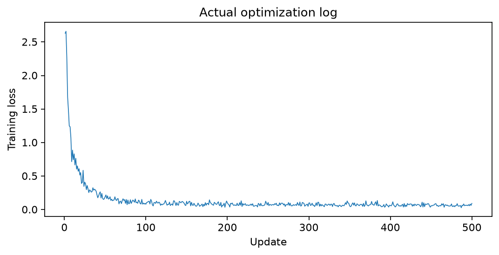

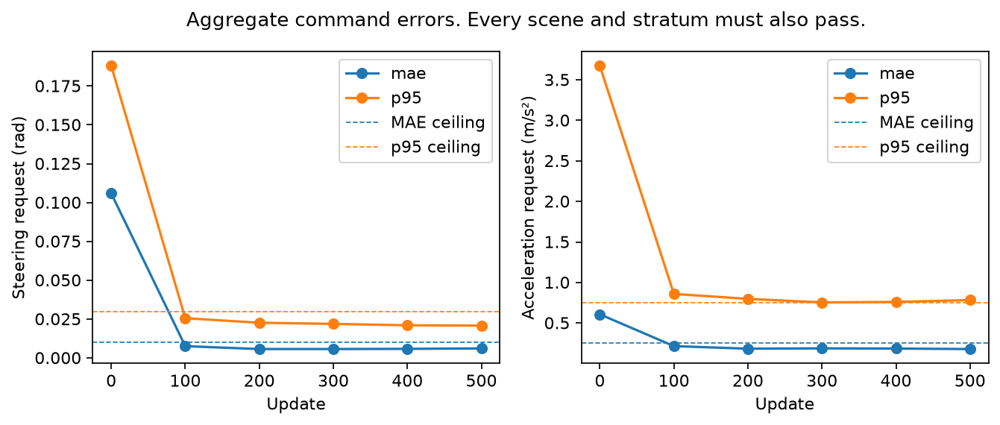

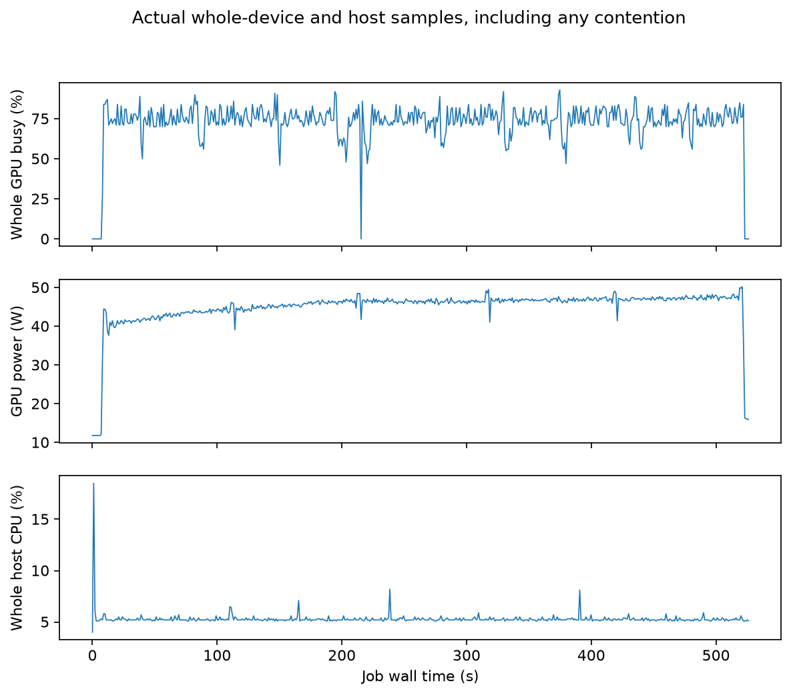

The frozen development protocol allows only step 500 of an unqualified run to undergo the bounded TRAIN pilot and one full exposed run per discipline. It does not permit qualification repeats. The six-second pilot made three physical contacts and one off-course event. [The first-error diagnosis](direct_command_diagnosis/result.json) finds understeering and insufficient braking before contact. At three seconds, the raw steering error against a privileged teacher query at the actual learner state was 0.11578 rad, and acceleration error was 1.5638 m/s². Those labels were not supplied to the learned controller.

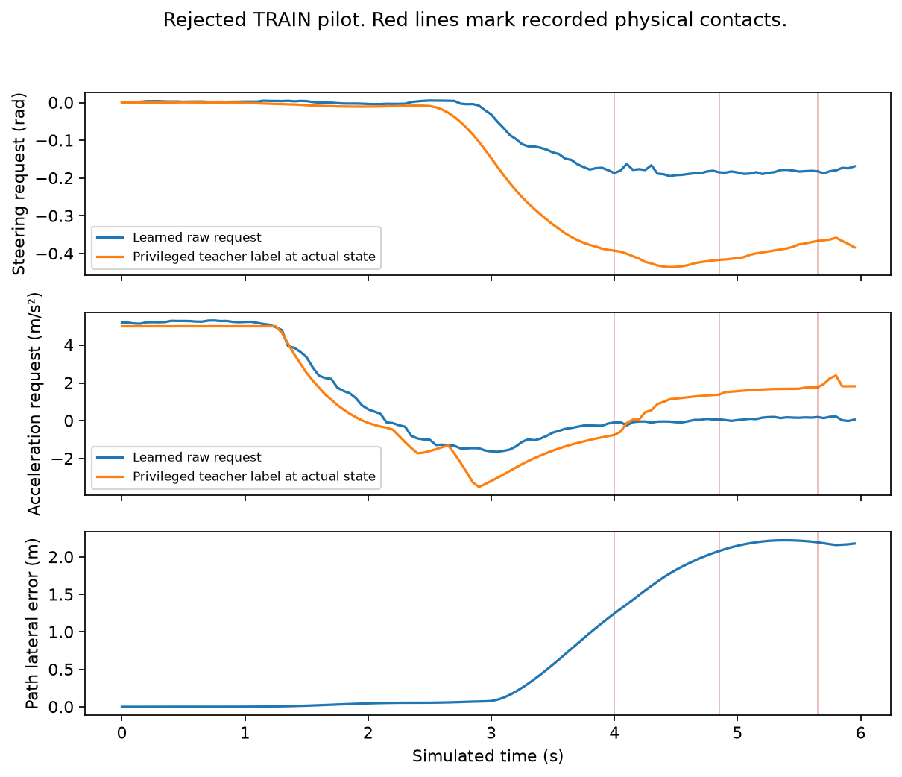

Full CUDA replay of all 120 pilot frames passed at the original 1e-5 numerical tolerances. CPU replay failed on unchanged image and plan diagnostics, while the learned command checks matched. The CPU failure remains retained and does not qualify the model. The producer artifact audit reconstructs the declared float32 proprio inputs with no tolerance change. Both actual debug and research videos passed full 160-frame decoding. Their banner distinguishes frozen plan diagnostics from learned executed commands. [The video audit](direct_command_pilot/lab_video_audit.json) binds producer rendering and portable encoding.

The full exposed skidpad diagnostic timed out after 120 simulated seconds with 14 physical contacts, seven off-course events and no accepted laps. The exposed track diagnostic also timed out at 120 seconds with three contacts, two off-course events and no completed lap. Its legacy `raw_time=0` and penalty-derived `time=26` do not represent a completion time. These are rejected-model failure diagnostics, not final acceptance samples. The next experiment added independently verified on-policy TRAIN recovery data from the missed entry state. Its results appear below.

## Reproduction and retained artifacts

[The source copy receipt](direct_command_source/published_copy_receipt.json) binds exact experiment-source copies and training receipts. Restore the files in `direct_command_source` to `.work/lab/direct_command_trial` from the repository root to preserve their bound paths. The training source archive also retains the exact original runtime sources and explicitly mapped external dependencies. Full checkpoint packages remain under the ignored local `runs/direct_command_trial3_archive` directory, with all six hashes verified in its published copy receipt. No failed checkpoint was removed.

The local report is `runs/driving_reliability_report/index.html`. It includes native traces, command and appearance probes, actual training and validation curves, hardware samples, first-error plots, and all 26 encoded views from the inherited comparison and the direct, recovery, and joint trials. Its evidence inventory hashes every consumed artifact. Each new episode is added after saved-input replay, producer audit and video verification complete.

The [work plan](../../docs/isaac-lab-training/reliability_work_plan.md) and append-only [decision log](../../docs/isaac-lab-training/decisions.tsv) record continuation state. New diagnostics use the existing RAM-backed workspace. The running container, unrelated CFD processes and inherited evidence are preserved.

## Corrective data collection

The first new episode switches the frozen rejected learner to the teacher at tick 63, before contact. The teacher completes full R,R,L,L, exit and stop with zero physical contacts and zero off-course events. The independent verifier replays all 64 prefix frames on CUDA, checks every saved training desire, confirms 200 actual terminal braking ticks and qualifies 219 anchors. Ten anchors lie in the first two seconds after handoff. The settling window starts at tick 95. This is qualified training data, not learned-model performance. [The data receipt](direct_command_recovery_data/skidpad/receipt_v2.json) and [metadata](direct_command_recovery_data/skidpad/meta.json) bind all arrays and source bytes.

The [first verifier receipt](direct_command_recovery_data/skidpad/failed_receipt_v1.json) failed because JSON writes a vehicle parameter tuple as a list. The scalar values, mount, camera and scene matched. A separately versioned [derived verifier](direct_command_recovery_source/verify_v2.py) applies the producer's JSON serialization to the expected vehicle dataclass. The original collector, verifier, protocol, failed receipt and source archive remain intact. No numerical or physical gate changes. The track recovery also passes independent verification. It switches at tick 164, settles from tick 178, completes with zero contacts and zero off-course events, and supplies 205 qualified anchors. All 165 prefix frames replay on CUDA. [Its receipt](direct_command_recovery_data/trackdrive/receipt_v2.json) binds the cached track geometry and actual camera history.

The [prepared data-only training trial](direct_command_recovery_trial_source/protocol_v2.md) draws 16 old recovery, 16 new recovery and 96 ordinary anchors per batch. A fresh head uses the original 500-update optimizer and validation limits. Both new data receipts must pass before its audit or optimization can start. The independent source review found no blocker, and three CPU sampler and receipt-rejection tests pass. The audit passed and the discarded wiring head reached its unchanged thresholds at update 196. The main fit completed all 500 updates. Every scheduled checkpoint failed validation, so none was selected. See the results below.

## Recovery-data fit and measured driving

The data-only fit completed all 500 updates and all six validation snapshots. Step500 aggregate MAE was 0.00622419 rad and 0.19858789 m/s². Its p95 was 0.02445922 rad and 0.82706383 m/s². Every snapshot fails the unchanged limits, including the same three track episodes and low-speed steering. [The validation record](direct_command_recovery_training/validation_500.json) remains a rejected-model result.

The original training process then exhausted its 1024-descriptor limit while reopening data for its final audit. [Its failed receipt](direct_command_recovery_training/train_failure.json) and all six full checkpoints remain retained. A separate fresh-process [read-only postflight](direct_command_recovery_training/read_only_postflight.json) verifies all 417 unchanged base tensors in all six packages, the complete data and source identities, and an exactly matching recomputation of all 2067 final validation anchors. It resumes no optimizer updates and selects no checkpoint. It reconstructs sampler counts from the frozen seed and labels them as reconstructed.

The telemetry wrapper recorded 469.14 seconds and 469 samples, with return code 1. Median whole-device utilization was 81%, median power 49.733 W, median whole-host CPU use 6.0%, and peak sampled whole-host RAM 9.21 GiB. A source-preserving archive copy overlapped this job. These figures are not an isolated speed comparison, and the failed postflight means the durations do not cover equivalent work to the previous successful bookkeeping run. Process-level peak PyTorch allocation was not saved by the failed stage. [All hardware samples](direct_command_recovery_training/hardware_measurement.json) remain available.

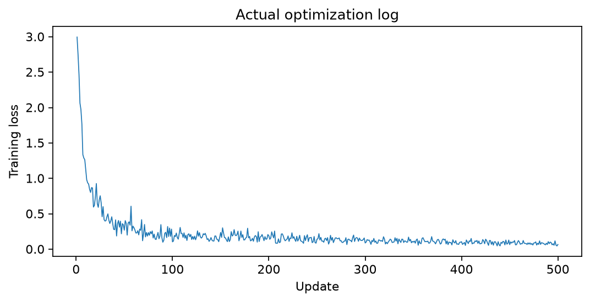

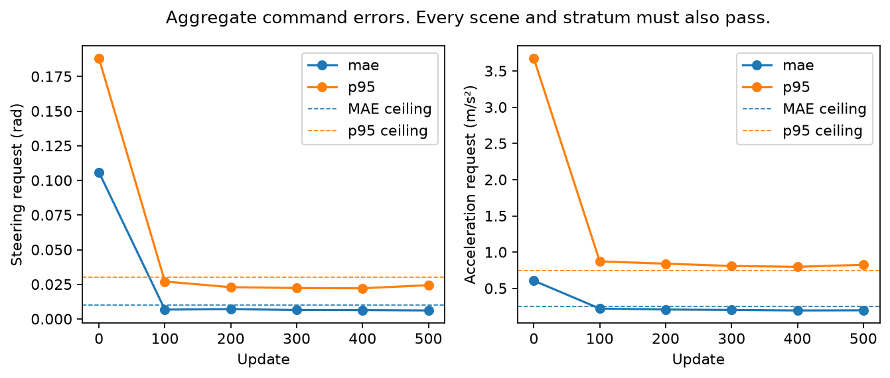

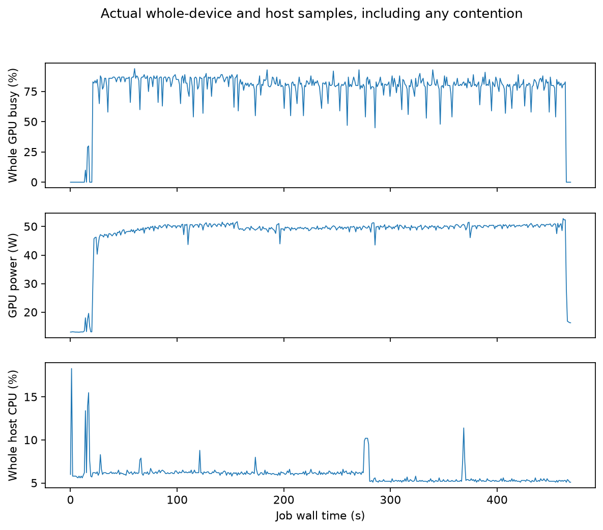

| Diagnostic | Frames | Simulated seconds | Physical contacts | Off-course events | Result |
|---|---:|---:|---:|---:|---|
| TRAIN pilot | 60 | 3.0 | 2 | 0 | Invalid initial entry |
| Exposed heavy skidpad | 60 | 3.0 | 2 | 0 | Invalid initial entry |
| Exposed heavy track | 2400 | 120.0 | 10 | 13 | Timeout, incomplete |

These are one run per case. The shorter skidpad failure is not an improvement in contact count. The pilot cannot pass the required 120-frame integration gate. [The new first-error diagnosis](direct_command_diagnosis/result_recovery2.json) finds premature steering. At tick50 the head requests -0.21527 rad while a privileged teacher query at the actual state requests +0.13544 rad. Setting yaw rate to zero at that fixed latent changes the request to -0.16232 rad, accounting for only part of the discrepancy. Raw head replay differs by at most 3.34e-6. Those interventions are diagnostic predictions, not driving outcomes.

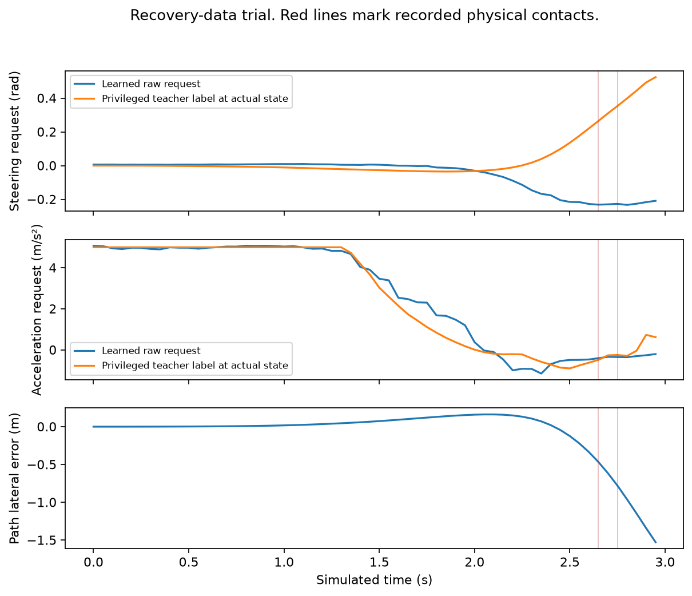

Both recovery-data views for each diagnostic passed producer audits and complete video decoding. The [compact pilot evidence](direct_command_recovery_pilot/) and [full exposed pair evidence](direct_command_recovery_development/) preserve the actual CUDA replay identity and all original tolerances. A replay verifies saved inputs and outputs; it does not rerun physical simulation.

## Joint policy suffix

The [frozen joint experiment](joint_command_source/joint_command_trial/protocol.md) trains the final three policy affine modules and the same command head. It optimizes 296450 values in ten tensors and keeps the other 411 base state tensors unchanged during training. Every full package contains all 417 updated base states and four head states. Every deployed tensor must match that saved package. Raw command targets and all existing validation, visual, driving, and final gates remain unchanged.

Independent review found verifier-ownership and failed-stage transition gaps before launch. Both were fixed and rechecked before source freeze. The real Spark audit passed. One disposable update improved its fixed-batch loss and changed every intended tensor, with the 411-state complement unchanged and exact updated-package roundtrip. Fresh disposable wiring passed at update56. All conditioning and wiring weights were discarded before the main run.

The main run completed 500 updates and its independent fresh-process postflight passed. All six checkpoints failed the unchanged command validation gates. Step500 aggregate MAE was 0.00652104 rad and 0.17697710 m/s²; p95 was 0.02349217 rad and 0.78139103 m/s². Three track scenes and low-speed steering also failed. No checkpoint was selected. [The training receipts](joint_command_training/train.json) and [archive receipt](joint_command_training/local_copy_receipt.json) bind all six full packages. The 27-file local archive is byte-exact with the preserved Spark source.

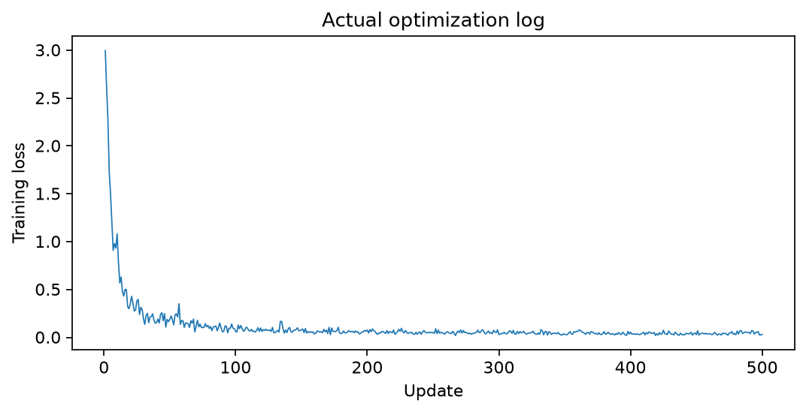

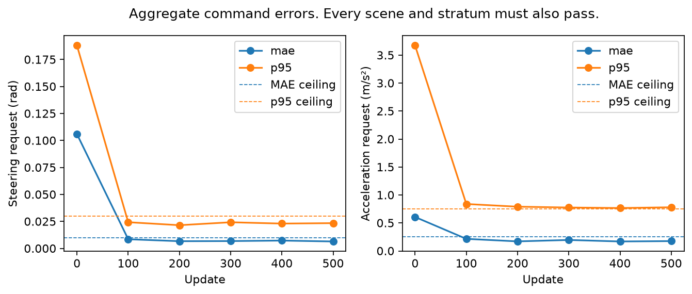

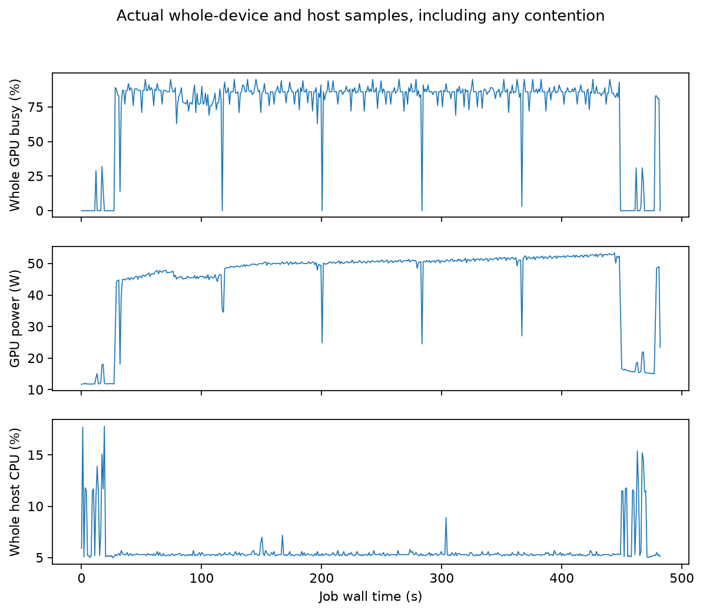

The job recorded 446.84 seconds internally and 482.25 seconds in its external wrapper. The wrapper sampled 482 times, with median whole-device GPU utilization 86%, power 50.1875 W, whole-host CPU use 5.3%, and peak sampled host RAM 9.95 GiB. Peak PyTorch allocation was 1361847808 bytes. These are achieved job measurements, not an isolated speed comparison or FLOPS efficiency.

The fixed step500 [CPU runtime diagnostic](joint_command_training/runtime.json) passed repeated commands and head reconstruction over 184 saved TRAIN frames at the original 1e-5 tolerances. Mean forward time was 0.13018 seconds and p95 was 0.13652 seconds, excluding physics, rendering and evidence writes. This backend does not establish a real-time 20 Hz rate. The rejected checkpoint's [six-second TRAIN pilot](joint_command_pilot/summary.json) recorded three physical contacts and zero off-course events. All 120 saved frames replay on CPU, the producer artifact audit passes, and both video views fully decode at 160 frames. Only the predeclared one-run exposed pair may follow this rejected model. The final acceptance suite remains unopened.

That exposed pair is complete. Skidpad finishes the full valid R,R,L,L route, exits and stops in 50.3 seconds, but records nine physical contacts. Its recorded lap durations are 10.3867, 10.9694, 11.1679 and 10.7624 seconds. Trackdrive times out at 120 seconds with six contacts and ten off-course events. All 3406 saved frames replay on CPU at 1e-5, and both producer artifact/render audits pass. The [local archive receipt](joint_command_development/local_copy_receipt.json) records 3486 files and 4209215861 bytes with matching source and local inventories. The [compact evidence index](joint_command_development/publication_index.json) links both cases and the full decode audit for all six joint views. The [completed report plots](plots/joint_trial_complete/plot_copy_receipt.json) bind the joint first-error, loss, validation, and hardware plots to the report snapshot. These are single exposed diagnostics, not reliability estimates. The skidpad's legacy `pass=true` does not satisfy the explicit zero-contact predicate.

## Testing the shared premise

[The fixed-input teacher analysis](corridor_design/premise_diagnostic_v1.md) finds correct same-tick alignment in the inspected data builder. Three TRAIN teachers use a different steering lookahead. Changing only that setting at saved precontact states changes steering by up to 0.06334 rad, with no acceleration change. This material difference cannot explain the full observed command error or establish that the unchanged validation gates are impossible. Hidden-future acceleration ambiguity remains unproved.

The first two direct heads have precontact steering MAE of 0.05340 and 0.05851 rad at their own states, against privileged teacher queries. Their offline aggregate MAEs near 0.006 rad describe a different state distribution. These correlated prefixes share one TRAIN scene. No reliability estimate follows from those tick counts.

[The cone audit](corridor_design/geometric_option_probe/cone_quality.py) checks saved predictions in those same precontact prefixes. At 5–10 m, 354 of 360 blue/yellow predictions associate with a same-color actual cone within 0.75 m. Matched-error p95 is about 0.25 m in each prefix. Nearer and farther detections are less reliable. This matching threshold is not a safety bound, and frustum visibility does not account for occlusion.

The [full TRAIN detector record](vision_corridor_detector_record/receipt.json) passes source/input and repeated-inference checks on 286 skidpad and 287 track stored frames. [Its quality analysis](vision_corridor_detector_quality/report.md) separates driving from appended braking. Accurate detections do not imply two-sided availability. Both boundary colors are absent together at 5–10 m in 201 of 236 skidpad driving frames. These trajectories include an initial learner interval, so their controls are not all teacher labels.

Two independent sketches compare a [deterministic route-aware planner](corridor_design/geometric_option_v1.md) with a [learned local corridor](corridor_design/learned_corridor_candidate_v1.md). The frozen [deterministic prototype](vision_corridor_prototype/README.md) returns unknown and braking on all 706 selected recorded frames. In 366 it finds no eligible gates; in 340 it cannot establish a nearfield seed. No frame reaches a path. This rejects its support and bootstrap contract, not geometric topology generally. Seven behavioral tests and exact repeated replay pass, but they cannot turn zero supported paths into a successful planner. No physical run uses it.

[The launch audit](launch_supervision_audit/report.md) also rules out a global supervision gap. Twenty-four TRAIN episodes retain launch labels. The completed joint fit samples 2349 early targets, 480 early low-speed targets and 143 standing-start targets, covering all 72 unique early low-speed observations. Seven qualified replaced cases lose their launches, but this does not establish absence of supervision as the failure cause. The 200-tick filter excludes no additional early teacher target.

The next bounded implementation supplies a new 47618-parameter head with individual predicted cone positions, classes, scores, full supplied route history and measured body motion. All 417 original base states remain frozen. Commands read the current image pair rather than the old policy's temporal summary. Same-tick raw teacher targets, sampler, optimizer and every existing gate remain unchanged. A fresh full CPU validation of the single GPU-selected package is an additional deployment gate. Conditioning and fixed-32 wiring weights must be discarded before any main fit. The reviewed source was frozen before its real Spark audit and disposable optimization. Ground truth stays in labels and scorers. All physical, validation-driving and final acceptance predicates remain unchanged.

## Cone-set capacity and conditioning results

The [frozen cone-set implementation](cone_set_source/published_copy_receipt.json) passes 39 CPU checks and its real Spark source, data, decoder and original-state audit. One disposable update improves fixed-batch loss from 3.470381 to 3.418927, with all eight head tensors changing and all 417 original base tensors unchanged. Exact package roundtrip passes. This establishes wiring only.

The fresh 32-anchor capacity stage then fails after 200 updates: steering MAE is 0.005447729 rad against 0.002, and acceleration MAE is 0.314533442 m/s² against 0.05. [The failure receipt](cone_set_preflight/overfit_failure.json) remains alongside [the final errors](cone_set_preflight/overfit.json). Its 71.8403-second duration includes data verification. Only final wiring errors were saved, so there is no per-step loss curve or isolated hardware speed claim. No main training, selected model, or physical scene follows this failed gate. The disposable weights were never written as a checkpoint; all files actually created are retained.

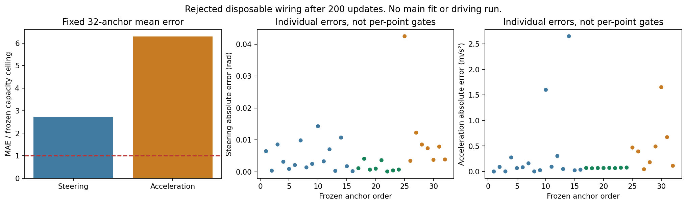

The plot shows per-anchor errors and the mean-error limits; individual points have no separate gate. [The rendering script](plots/cone_set_capacity_v1/plot.py) rerenders those measurements into a fresh output directory. The original inline-rendered image and its hash receipt remain preserved.

The separately frozen [conditioning diagnostic](cone_set_conditioning_probe/report.md) makes no parameter updates. Layer normalization increases median physical geometry sensitivity by factors of 17.94 and 11.01. It still fails the frozen recommendation rule: minimum motion-sensitivity retention is 0.720 and 0.809, below 0.90 per anchor. Readout conditioning improves 6.52-fold, below its alternative tenfold threshold. No normalized-head fit is promoted.

The [vehicle forecast diagnostic](native_plant_forecast_probe/report.md) replays known future applied controls only for scoring. At one second the joint pilot exceeds the proposed 0.20 m front-effect proxy in 3 of 62 overlapping starts, with maximum 0.240 m. This proxy is not an exact conservative footprint bound, and these correlated windows are not reliability samples. The result rejects assuming that margin protects a one-second optimizer forecast.

The next bounded prototype uses the original neural path as a route prior and predicted cones to estimate a local lateral correction, then tracks it with measured body motion. It must establish support and reference accuracy on recorded TRAIN prefixes before any native launch. Ground-truth pose, cones, progress and centerline stay in scoring. No model qualifies, and the final suite remains unopened.

## Rejected neural-path correction

The [frozen constant-offset prototype](vision_corrected_plan_prototype/README.md) uses original neural plans, predicted cones and measured body motion on 133 strict precontact TRAIN frames. It returns supported geometry on 97 frames. Corrected lateral MAE is 0.4031 m versus 0.3054 m for identical uncorrected inputs. Teacher steering-direction agreement falls from 35/41 to 27/41. Supported static sampled footprint conflicts rise from 43 to 65. Both frozen episode screens fail. Five behavior checks pass and two replay processes produce identical outputs. No native rollout follows.

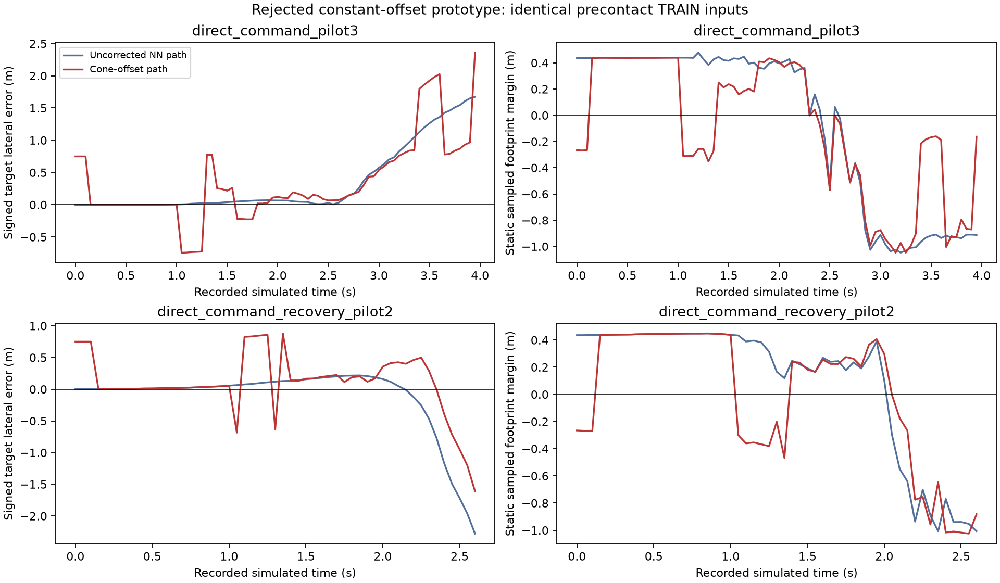

The post-result attribution isolates cone-position error from boundary membership. All 97 median support detections associate with an actual cone within 0.40 m. Yet some accurate cones belong to a nearby different boundary. At direct frame21, a yellow cone about 3.05 m from the entry center is treated as a 1.5 m boundary, shifting an accurate target by about 0.75 m. A constant translation also cannot repair a badly oriented neural trajectory. These observations motivate testing explicit boundary membership and geometry. They do not prove a complete perception solution or any successful controller.
