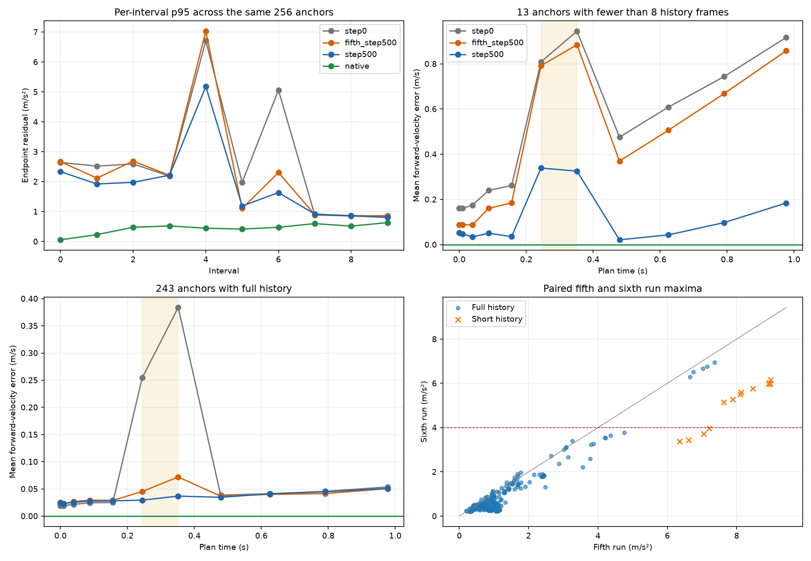
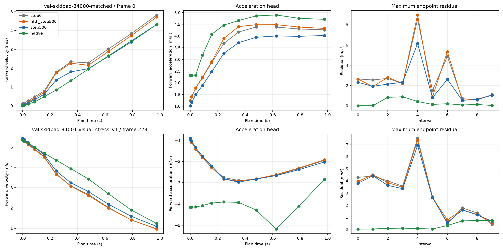

# The native target repair reduces the residual tail but leaves compensating errors

The goal is native Isaac training that reduces cone contacts and timeouts with auditable videos. This analysis explains the sixth rejected training run on its existing 256 validation anchors. It does not promote a checkpoint, modify the controller, or establish the cause of a physical failure.

The [analysis script](../analyze_native_future_residual1.py) verifies the saved replay output hashes, the run and selection bindings, all immutable anchor records, episode hashes, native targets, observed states and native actions. The fifth and sixth runs have identical step-zero predictions. The script independently reproduces the current run's aggregate plan and action losses, per-episode action losses, and all 16 aggregate coherence metrics within fixed absolute and relative tolerances of 1e-5. [analysis.json](analysis.json) retains every anchor comparison and all calculations.

Both the fifth and sixth source archives were rehashed locally against their bound run metadata and replay reports. Both replay arrays and reports were also rehashed. The fifth archive was fetched after the initial analysis. Repeating the analysis left every numerical result unchanged and refreshed the archive-verification binding and plot hashes. No model inference or optimizer operation ran in this analysis.

## The remaining tail still occupies interval 4

Fourteen sixth-run anchors exceed the frozen 4 m/s² maximum cap. All fourteen were also failures in the fifth run. Nine have fewer than eight history frames. The five full-history failures comprise trackdrive 84002 frame 201 and skidpad frame 223 in each of four visual variants.

Every one of these fourteen maxima occurs at the start endpoint of interval 4, from 0.15625 to 0.244140625 seconds. Forward x accounts for 99.874% of their summed absolute residual components. At each failing anchor's worst endpoint, the exact native-relative decomposition is

`model residual - native residual = acceleration prediction error - finite difference of velocity prediction error`.

Projected onto each anchor's excess-residual direction, the mean contribution is 1.8354 m/s² from acceleration error and 4.1569 m/s² from differentiated velocity error. Their sum is 5.9923 m/s². Both terms matter.

| Group | Anchors | Fifth mean / p95 / maximum | Sixth mean / p95 / maximum | Fifth / sixth anchors above 4 |
|---|---:|---:|---:|---:|
| All | 256 | 1.642 / 7.030 / 8.981 | 1.146 / 5.180 / 6.942 | 22 / 14 |
| Fewer than eight history frames | 13 | 7.943 / 8.976 / 8.981 | 5.072 / 6.084 / 6.161 | 13 / 9 |
| Eight history frames | 243 | 1.305 / 3.531 / 7.363 | 0.936 / 3.111 / 6.942 | 9 / 5 |

The figures are descriptive results from one deterministic paired replay. Anchors and visual variants are correlated. They are not independent physical trials.

## The current action objective still rewards some compensating errors

For the thirteen short-history anchors, mean forward-velocity errors at knots 4, 5, 6 and 7 are +0.0354, +0.3390, +0.3253 and +0.0213 m/s. Mean forward-acceleration errors at those knots are -1.7729, -1.0794, -0.6085 and -0.3468 m/s². The speed and acceleration terms partly cancel in the longitudinal command.

Measured directly through the deployed follower, the short-history group's mean speed-feedback error contributes +0.49783 m/s². Its tangent-acceleration term contributes -0.41724 m/s². Their sum is a mean command error of +0.08059 m/s². A relatively accurate command can therefore coexist with substantial errors in its component predictions.

The fixed saved-output intervention replaces only velocity knots 5 and 6 with time-linear interpolation between the same prediction's knots 4 and 7. It changes neither acceleration nor uncertainty. It uses no native values to construct the replacement. Both actual and intervened commands remain within each anchor's recorded vehicle limits, so clipping does not explain the comparison.

| Group | Actual / intervened residual mean | Actual / intervened residual maximum | Change in plan NLL | Change in native-target longitudinal loss | Change in weighted current objective |
|---|---:|---:|---:|---:|---:|
| All 256 | 1.146 / 0.871 | 6.942 / 4.424 | -0.00210 | +0.02245 | +0.02035 |
| Short history | 5.072 / 2.363 | 6.161 / 3.355 | -0.01392 | +0.24840 | +0.23447 |
| Full history | 0.936 / 0.791 | 6.942 / 4.424 | -0.00147 | +0.01037 | +0.00890 |
| Fourteen actual failures | 6.043 / 3.078 | 6.942 / 4.424 | -0.01295 | +0.22136 | +0.20841 |

The intervention improves residual maxima on all fourteen actual failures but worsens the weighted current objective on eleven. It reduces the number of anchors above 4 from fourteen to four. Across the unchanged 432 aggregate and episode coherence bounds, failed checks fall from 27 to 14 and no previously satisfied coherence bound fails. The aggregate p95 and maximum acceleration bounds still fail after the intervention. All four episode steering regressions remain unchanged.

This does not recreate the previous exact-target incompatibility. A perfect native plan still matches its own controller target. The result establishes a local compensation pattern in this particular trained prediction. Correcting velocity alone removes part of that compensation while leaving the acceleration error in place. It does not establish that a network update can make the same isolated change.

## Steering and uncertainty remain separate evidence

The four episode steering failures against the native-controller target are retained below. Steering SmoothL1 uses beta 0.05. Velocity-only interpolation cannot change this follower's steering output.

| Episode | Step zero | Sixth step 500 | Frozen ceiling |
|---|---:|---:|---:|
| Trackdrive 84002 visual stress | 0.00269451 | 0.00302727 | 0.00296396 |
| Trackdrive 84003 visual stress | 0.00191037 | 0.00211606 | 0.00210141 |
| Skidpad 84002 visual stress | 0.00010070 | 0.00012890 | 0.00011077 |
| Skidpad 84003 visual stress | 0.00024110 | 0.00028220 | 0.00026521 |

The largest increases in individual steering losses include trackdrive 84002 frame 154, trackdrive 84003 frame 0, and skidpad 84002 and 84003 frame 111. These are offline validation anchors. They are not evidence about when a physical rollout first hit a cone. The JSON preserves every anchor's actual action and loss.

The uncertainty evidence does not support a blanket claim that inflated uncertainty explains the tail. On short-history anchors, the mean effective NLL coefficient on velocity knot 5 increases from 0.00856 at initialization to 0.02846 at step 500. The corresponding acceleration coefficient increases from 0.000820 to 0.001468, even while its mean absolute acceleration error rises from 0.619 to 1.079 m/s². These are output-loss coefficients, not parameter gradients. Coefficients, errors and log scales are reported for every near-horizon velocity and acceleration column in every group.

## What this supports next

A native-relative consistency term is mathematically coherent. For endpoint e of interval i, define `R_i,e(P) = a_i+e - (v_i+1 - v_i)/dt_i`. Penalizing `R(mu) - R(native)` targets the demonstrated coupled prediction error and has zero loss at the native plan. Penalizing `R(mu)` toward zero instead would force adjacent endpoint accelerations toward equality. Native residuals are nonzero, so that would impose the wrong exact target.

This replay supports investigating a coupled velocity-and-acceleration correction. It does not select a penalty coefficient or justify another training run. A TRAIN-only, no-update parameter-gradient diagnostic at the rejected checkpoint would need to compare the current objective with a precisely defined native-relative residual objective on fixed affected and ordinary anchors. It must report gradient directions and magnitudes, the effect of the nonuniform time intervals, and possible steering interference. A source-frozen physical trace must separately establish the first departure from successful behavior. An offline coherence improvement cannot substitute for that evidence.

Attack the Premise required repeating the localization on the sixth run rather than inheriting the fifth run's explanation. Fix Root Causes kept the velocity and acceleration contributions separate. Explain the Number kept one paired offline replay separate from physical success. Model the Domain organized the code around bound replay records. Build the Lever produced the rerunnable script and complete per-anchor calculations.
