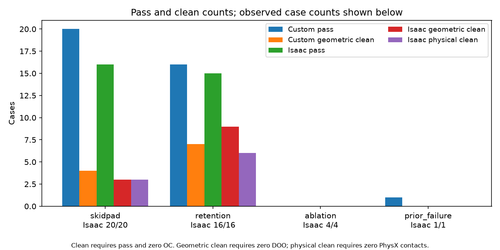
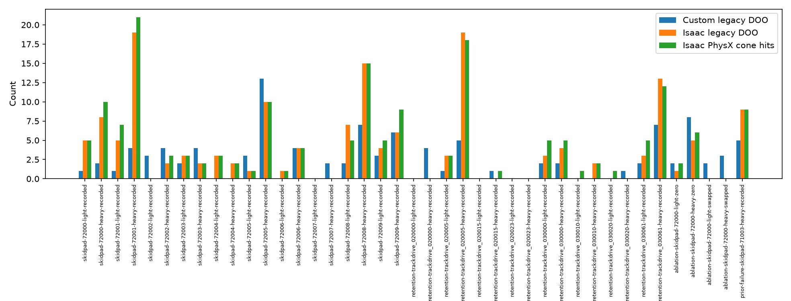
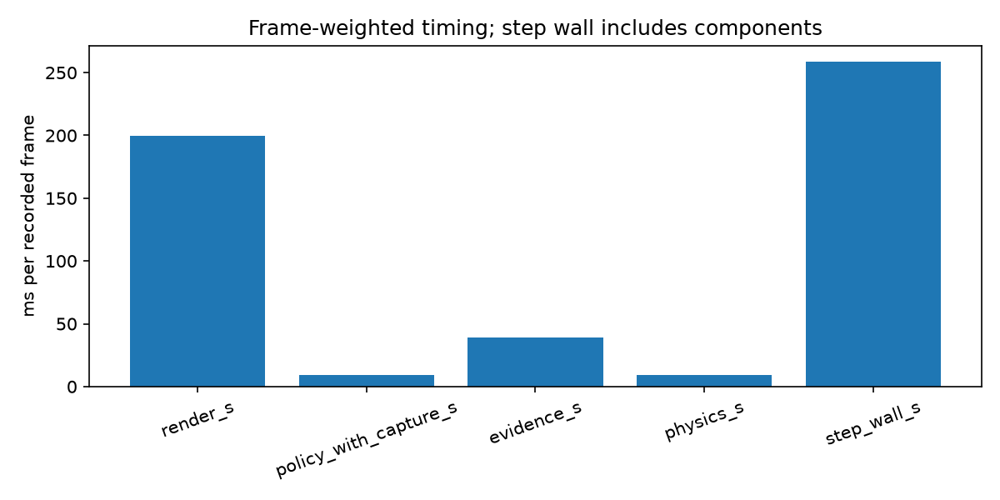
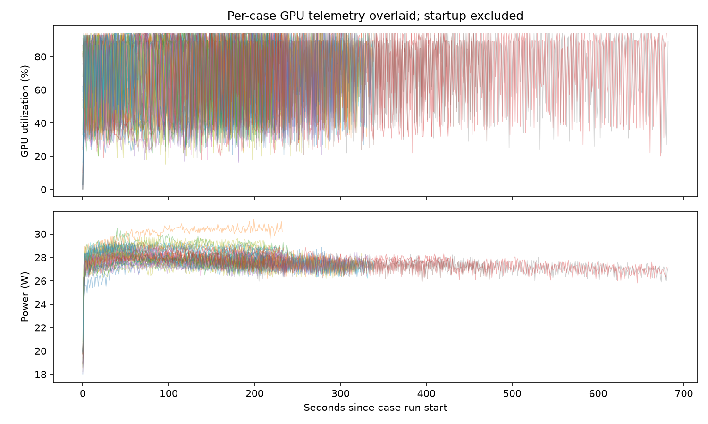

# Frozen Isaac evaluation with custom-simulator diagnostics

The goal was to show the custom simulator's tests and debug videos in Isaac Sim, including actual vision inference and failures. This run uses the same 41 case identities, frozen checkpoint, controller, and referee as the archived custom evaluation. All 41 cases ran on the DGX Spark. The main comparison completed 31 of 36 driving cases, with nine physically clean finishes.

## Driving results

The main comparison contains 20 skidpad cases and 16 trackdrive retention cases. The four route-command ablations and one prior-failure case are separate diagnostics.

| Group | Cases | Completed | Geometric clean | Physical clean | Geometric cone penalties | PhysX cone contacts | Off-course events |
| --- | ---: | ---: | ---: | ---: | ---: | ---: | ---: |
| Skidpad | 20 | 16 | 3 | 3 | 97 | 106 | 17 |
| Trackdrive retention | 16 | 15 | 9 | 6 | 47 | 53 | 20 |
| Main comparison | 36 | 31 | 12 | 9 | 144 | 159 | 37 |
| Command ablations | 4 | 0 | 0 | 0 | 6 | 8 | 3 |
| Prior failure | 1 | 0 | 0 | 0 | 9 | 9 | 0 |

Completion and pass agree in this run. Geometric clean requires a pass with zero legacy cone penalties and zero off-course events. Physical clean requires a pass with zero unique PhysX cone contacts and zero off-course events. Cone contacts count each cone once per case. Completing the course does not imply clean driving.

The main completion rate is 86.1%. The physical-clean rate is 25.0%. Skidpad completed 10 of 10 light cases and six of 10 heavy cases. The four command ablations ended with invalid routes. The prior-failure diagnostic also ended with an invalid route. All technical executions succeeded, including the ten driving failures across all groups.

The archived custom main comparison completed 36 of 36 cases, with 11 geometrically clean finishes, 86 cone penalties, and three off-course events. Rendering, physics, scenery, platform, and trajectories differ. Historical initialization was reconstructed. These are matched cases, not a controlled physics-only comparison or a new training result.

## Videos and inference evidence

Every case has two 1280 by 768 videos at 20 simulation frames per second. Both preserve the full episode and a two-second terminal card.

- `debug.mp4` uses the custom simulator's compositor. It shows both cameras, the model path and scale, projected detection rings, the expert reference, the track map, and the ego map.
- `research.mp4` shows the raw image-head boxes and scores before ground projection. It also shows route commands, controls, counters, timing, and the input RGB hash.
- `debug.rrd` contains the interactive recording. The evidence directory retains lossless inputs and outputs from each actual inference call.

The predicted path drives the controller. The auxiliary cone head does not feed the path follower directly. Model scale and detection scores are uncalibrated. Green is a privileged offline expert reference using the custom bicycle model. Map dots are simulator ground truth. Neither is a vision prediction.

The local gallery is `isaac_eval/runs/parity_v1_report/index.html`. It contains all 82 final videos, a failures filter, per-case evidence links, and historical video comparisons where available. Historical videos are separate rollouts and are labeled accordingly.

Full raw evidence and all Rerun recordings remain at `max-spark:/home/maxaitel/fsop-isaac-debug-parity/isaac_eval/runs/parity_v1`. The workstation has every final MP4 and compact receipt. It also has full raw evidence and Rerun recordings for `skidpad-72000-light-recorded` and `prior-failure-skidpad-71003-heavy-recorded`. Large media and raw tensors are excluded from Git.

## Measured Spark performance

The suite recorded 42,295 inference frames and 10,952 one-second telemetry samples. Total suite elapsed time was 3 h 17 min 34 s. Episode run time was 10,943.2 seconds, with 539.1 seconds of startup. The remaining elapsed time includes process and orchestration overhead. Offline exports are outside these measurements.

| Measurement | Median | P95 |
| --- | ---: | ---: |
| GPU utilization | 74% | 94% |
| Device-reported GPU power | 27.82 W | 29.13 W |
| GPU temperature | 60 C | 62 C |
| Host CPU utilization | 21.3% | 23.3% |
| Host unified RAM use | 11.69 GiB | 12.01 GiB |
| Evaluator process RSS | 5.45 GiB | 5.49 GiB |
| Render time per frame | 196.25 ms | 235.50 ms |
| Policy with diagnostic capture | 8.81 ms | 12.60 ms |
| Evidence writing | 39.23 ms | 49.23 ms |
| Physics | 8.90 ms | 10.47 ms |
| Total step wall time | 255.86 ms | 296.34 ms |

Rendering dominates this instrumented evaluation. The real-time factor is 0.193 simulated seconds per run wall second. The measurements do not establish full hardware saturation or production inference throughput. Device-reported GPU power is not whole-system wall power. The timing plot shows frame-weighted means; the table reports medians and P95 values. Step wall time already includes the component timings.

## Verification and limits

Vehicle integration, camera matching, and a separate 120-frame inference pilot passed before the protocol was frozen. The pilot reproduced saved outputs exactly. Disabling diagnostic hooks left outputs unchanged. Blacking out the input images changed all 120 predicted plans. Full-suite inference was not independently replayed.

All 41 recorded-state artifact audits passed. They replay the original mission, route commands, and referee from saved states. They do not resimulate PhysX contacts or the final physics transition. Independent checks decoded all 82 final videos, checked all source and final video hashes, and verified every final Rerun footer and hash. See the [independent artifact review](independent-review.md).

The final local test run passed 183 tests and skipped four with `FSOP_SKIP_RENDER=1 uv run pytest -q`. `ruff check src tests scripts` passed. The final gallery was checked in the browser for all 41 cases, the ten-case failure filter, both video modes, playback, and a terminal failure card.

The first export implementation hashed Rerun files before closing them. Four recordings also lacked footers. Original audit receipts and incomplete files were preserved. Native Rerun migration repaired the four footers, and unordered semantic comparisons passed. That comparison ignores log time and row order. The finalizer changed only the recording hash and explicit repair lineage in each video audit. The future producer closes recordings before hashing them. Its 120-frame regression passed on the actual Rerun 0.42 runtime. The [provenance files](provenance) preserve executed sources and repair proofs.

The checkpoint SHA-256 is `cf3a8d253dfd5a417e1967d2d6dc8cdd0263e3d16d3f1f02f15495f490a83b7e`. The protocol binds the checkpoint, executable graphs, source inventory, case manifest, and integration receipts. Weights stayed frozen. The original training checkout stayed clean.

This uses an FS-size generic Ackermann PhysX vehicle, not a validated digital twin. Ground-truth speed, mission progress, and route commands remain controller inputs. One run per case does not establish statistical superiority or real-world reliability. Cone avoidance remains weak in these scenes.

The [case CSV](cases.csv), [machine-readable report](parity.json), and [receipts](receipts) contain the numeric results and provenance. The [method](../isaac-parity-method.md) defines the diagnostics and scoring. The [run guide](../../isaac_eval/PARITY_RUN.md) gives reproduction commands. These graphs describe evaluation, not training.
