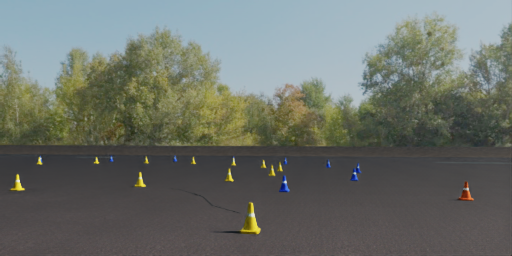
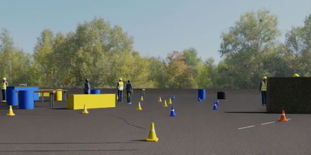
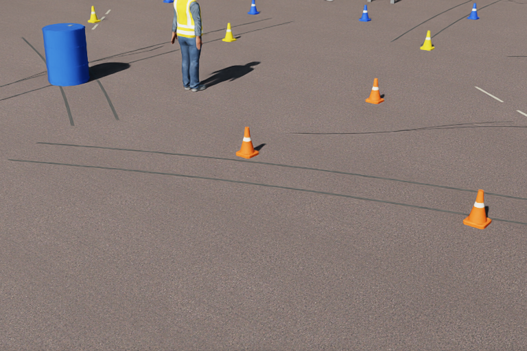
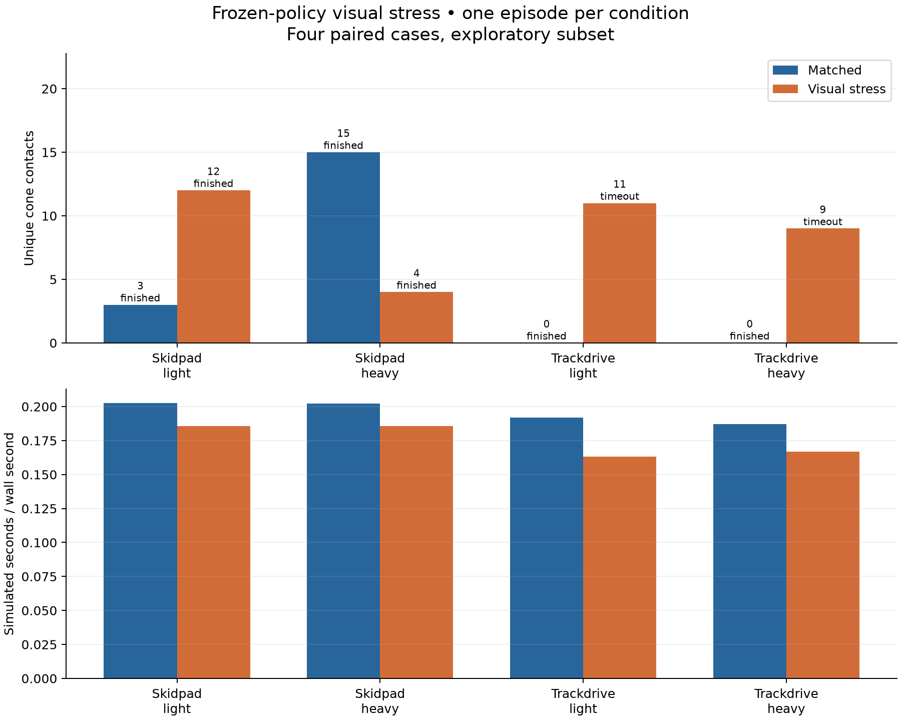
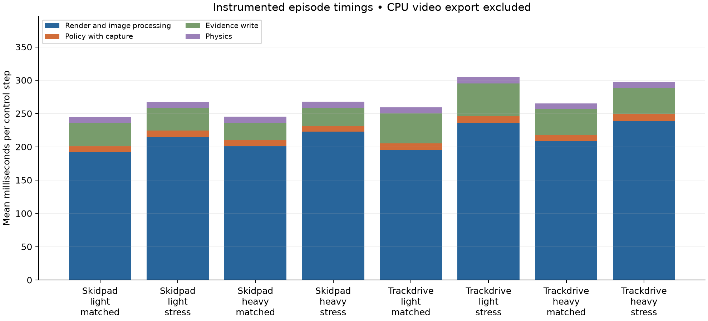
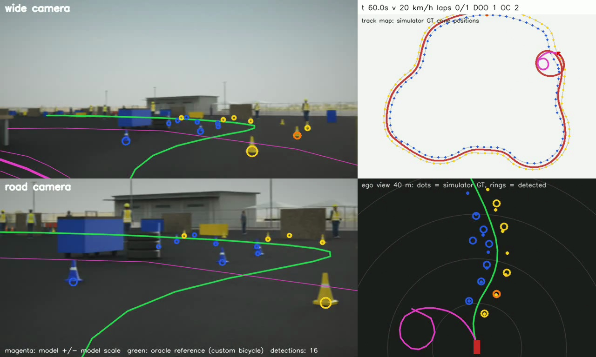
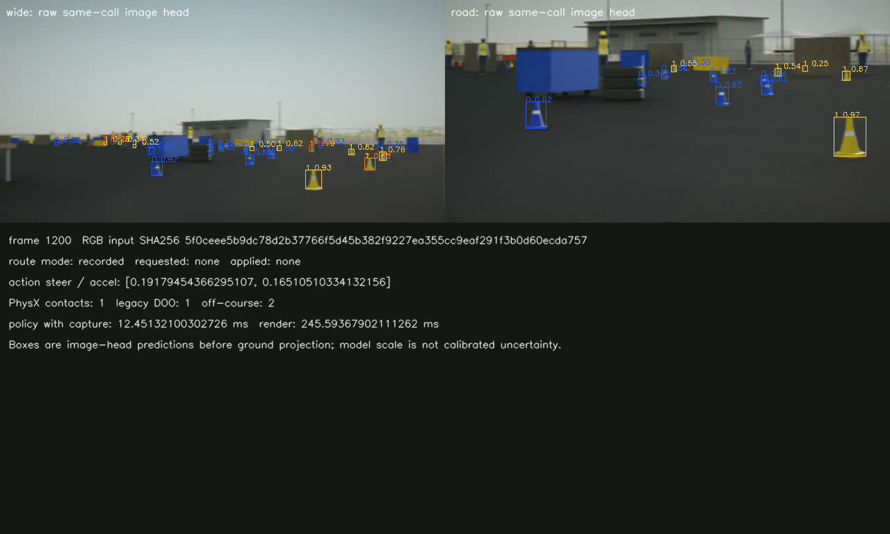

# Isaac visual stress results

This experiment adds realistic pavement detail, static people, walls and paddock objects to challenge the existing frozen vision model. The cases, scene and scoring rules were fixed before the scored runs. See [the method](../isaac-stress-method.md) and [the people asset recipe](../stress-people-assets.md).

The comparison uses four cases, each run with matched appearance and visual stress. It is an exploratory subset of the existing 41-case protocol. It does not estimate full-suite success or validate real-world pedestrian avoidance. The added people and props have no collision physics and remain outside the protected route corridor.

The videos use the existing evidence compositor. Its camera panels, captured vision-head detections, plan, model scale, controls, route command and debug data come from the saved episode. The debug view includes the offline expert reference. The research view shows the raw image-head detections before ground projection. No model predictions are regenerated when making the videos.

## Outcomes

Each row is one matched pair. Contacts count distinct cones with a recorded PhysX contact. A clean finish requires a referee pass, zero contacts and zero off-course events.

| Case | Matched outcome | Stress outcome | Matched contacts | Stress contacts | Stress off-course events |
| --- | --- | --- | ---: | ---: | ---: |
| Skidpad, light | Finished | Finished | 3 | 12 | 0 |
| Skidpad, heavy | Finished | Finished | 15 | 4 | 0 |
| Cone track, light | Finished | Timeout | 0 | 11 | 13 |
| Cone track, heavy | Finished | Timeout | 0 | 9 | 22 |

The matched arm finished four of four cases, with two clean finishes and 18 cone contacts. The stress arm finished two of four, with no clean finishes and 36 contacts. Both track timeouts ran for the full 120 simulated seconds. There were no technical execution failures. The eight episodes recorded 11,101 inference frames.

The skidpad effect was mixed. Contacts increased in the light case and decreased in the heavy case. The two track cases failed under stress after their matched runs finished cleanly. Each condition has one run, so these observations do not establish a repeatable effect size or a population completion rate. The added scenery combines several changes and does not isolate which object or surface detail caused a failure.

## Hardware observations

The eight scored processes took 55.22 minutes in total, including startup. The matched arm took 20.47 minutes and the stress arm took 34.75 minutes. The stress total includes two longer timeout trajectories, so this is not a renderer speed comparison.

Across individual episodes, GPU utilization medians ranged from 70 to 84 percent. CPU utilization medians ranged from 18.2 to 21.6 percent across the 20-core host. The highest sampled host RAM use was 12.7 GiB and the highest sampled GPU temperature was 68 degrees Celsius. Host measurements include other services. NVML device power is not whole-machine power.

Policy execution with capture averaged 8.55 to 10.93 milliseconds per control step. Rendering and image processing averaged 191.98 to 238.64 milliseconds. The complete instrumented step averaged 246.76 to 306.43 milliseconds. Real-time factor ranged from 0.163 to 0.203. Rendering was the largest measured part of each step. The capture and evidence costs remain included, and CPU video export ran only after all measured episodes finished. These are descriptive single-run measurements, not a repeatability-tested speedup claim.

## Artifact locations

The complete run on the Spark is `/home/maxaitel/fsop-isaac-vision-stress/isaac_eval/runs/stress_v1`. Raw inference chunks, flattened scene bundles, Rerun recordings, videos and audit receipts remain there. The local copy under `isaac_eval/runs/stress_v1` includes the report, videos and compact receipts. It omits the raw chunks and scene assets, so it is a viewing copy rather than a standalone audit bundle.

The renderer uses the original verified Isaac image with NumPy 1.26. CPU video export uses a separate container with Rerun and FFmpeg. The current training checkout and the original 41-case parity checkout remain separate.

## Camera preview

The same fixed route pose before and after the appearance change is below. Both images are the actual wide camera render from the source-bound preview.

The close overview shows the restored scanned asphalt detail, opaque weather variation, tar repairs and tyre marks.

## Graphs and receipts

The machine-readable paired report inside [the receipt archive](receipts.zip) contains every episode, hardware median/p95 values, video hashes and paired initial-state invariants. `plot.py` generates the graphs from that report. Raw contacts and referee events remain in each compact summary receipt and in the full Spark bundle.

## Verification

The full CPU suite passed 210 tests with four skips. Fresh vehicle and camera gates passed. Both 120-frame pilots passed frozen-model replay and debug-hook transparency checks. Black RGB input changed the predictions and controls on all 120 replayed frames in each pilot.

All eight recorded-state audits passed. The [independent artifact review](independent-review.md) checked all 11,101 raw frame hashes, all 16 final videos and all eight Rerun footers and hashes. The [local viewing-copy check](local-viewing-copy.json) matched all copied videos to their recorded hashes. The browser played both debug and research views of the light track failure without a media error. The report also verified all four paired initial-state invariants.

The frame below shows the light track failure at 60 simulated seconds. The magenta model plan loops while the green offline reference continues along the route. It is an observed failure example, not an attribution to a particular distractor. The second image shows the same frame's raw vision-head outputs.

The [compact receipt archive](receipts.zip) include the frozen plan, preview and gate receipts, pilot replay checks, episode summaries, completion seals and final audit receipts. The [preserved independent verification script](provenance/independent_verify.py) can be rerun inside the export container against the full `/work` bundle. The local viewing copy alone lacks the raw inputs needed for that audit. All executed runtime code was committed as `06df1a1` before the scored run.

The archive preserves the original JSON bytes. [The archive manifest](receipts-archive.json) records each member hash. Extract it to inspect `paired_report.json` and the receipts. Keeping generated receipts in one archive avoids a large generated-text diff.
