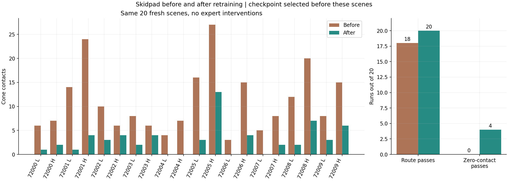
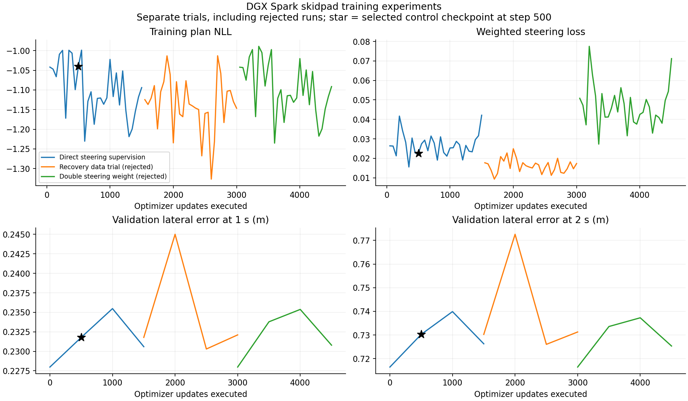
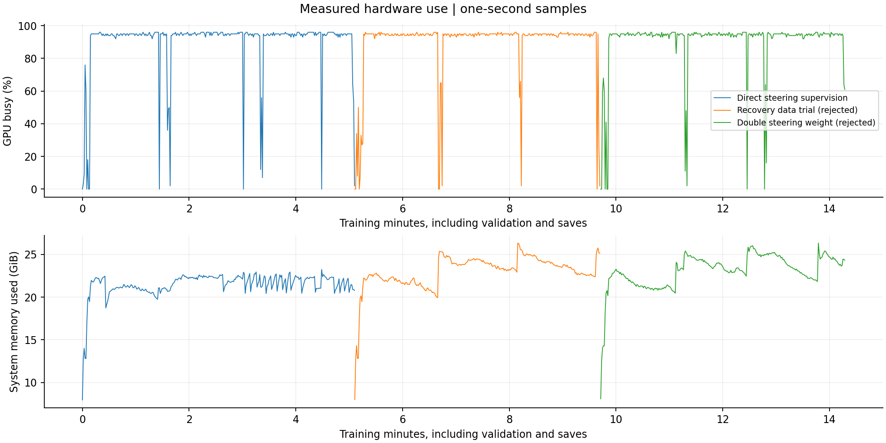

# Skidpad cone avoidance on DGX Spark

The goal is fewer cone contacts and correction of the heavy-randomization failure from the first skidpad run. The starting checkpoint is the full 31,154,802-parameter model from [the previous report](skidpad-training.md). This follow-up retains physical route scoring and uses no expert interventions during model evaluation.

The frozen model completed all 20 fresh skidpad scenes and reduced contacts by 72.4% against the old checkpoint on those same scenes. The previously failed heavy scene also completes its physical route. Cone avoidance is improved, but not solved. The worst fresh run still hit 13 cones.

| Fresh paired result | Before | After |
|---|---:|---:|
| Valid routes | 18/20 | 20/20 |
| Total cone contacts | 221 | 61 |
| Contacts per run | 11.05 | 3.05 |
| Zero-contact valid runs | 0/20 | 4/20 |
| Off-course events | 2 | 0 |
| Worst contact count | 27 | 13 |

Both models used the packaged textured venues, light and heavy scene randomization, and the same physical referee. The 20 cases are seeds 72000 through 72009 under both levels. They were first evaluated after checkpoint selection. No final case was used for training or tuning.







## Diagnosis

Reconstruction from the ten saved trajectories exactly reproduced the previous 134 cone hits. Of these, 121 first contacted the front of the car, and 98 occurred while the car center was within 0.9 m of the nominal centerline. The failed heavy scene at seed 71003 understeered during its first left circle.

At 31 seconds in that failed run, the learned model commanded 0.120 rad of steering. The direct expert commanded 0.326 rad. Applying the existing pure-pursuit follower to the expert trajectory produced 0.240 rad. The expert trajectory and the expert action are different targets. A future trajectory generated under feedback does not necessarily produce the same current action when followed by another controller.

The model predicts a `[33,15]` trajectory from images and command history. The follower consumes a position near 0.5 seconds to steer. The cone heads supply visualization and detection outputs, but they are not a separate collision-avoidance input to this follower. The existing plan loss spans ten seconds and does not directly supervise the steering action sent to the vehicle.

Recovery recording and live command histories matched at all 7,545 first-round and 6,938 second-round recorded ticks. No sampled command-history defect was found. Intermediate inference ticks and numerical feature-cache equality were not established by that check.

## Targeted training change

Training now optionally maps the predicted trajectory through differentiable pure-pursuit geometry and compares steering with the direct expert action recorded at that observation. The added sample values are a steering target, validity mask, and vehicle geometry. Timestamp matching rejects missing, duplicate, or misaligned labels. Only labeled recovery samples contribute to this term. Existing trajectory and cone losses remain, as does the full trackdrive replay mix.

The runtime model, follower, input interface, and physical referee remain unchanged. The new labels are privileged training supervision. The option defaults to zero weight for other training recipes. Frozen vision and image-head tensors remain in the full checkpoint. Fixed-interval checkpoints allow live selection even though the original validation data has no direct steering labels.

A fixed eight-batch BF16 calibration contained 2,048 samples, of which 719 had direct steering labels. The chosen weight, 3.281158, gives the steering term a pooled parameter-gradient norm equal to 20% of the plan term. Their pooled gradient cosine was -0.0624. This is a calibration heuristic, not evidence of improved driving.

A dynamics-aware controller was considered as an alternative. It would add state estimation, dynamics assumptions, and runtime computation. The smaller training change was tested first. The existing alternate follower failed all six development cases. A uniform 15% steering increase also made contacts worse, so neither change was retained.

## Development protocol

Primary development cases use seeds 61000, 61001, and 71003 under light and heavy randomization. The last seed includes the previously failed scene. All previous validation and test scenes may now serve as exposed regression cases. They are not described as fresh tests.

The final generalization suite is fixed to seeds 72000 through 72009 under both randomization levels. Neither candidate selection nor training uses those scenes. The video is fixed to seed 72000 with light randomization. The final model is also checked against the existing 16-case trackdrive suite.

The unchanged checkpoint was rerun before training. It passed five of six primary cases with 60 contacts and three off-course events. Small contact-count differences from earlier runs show that bitwise simulator reproducibility has not been established.

| Candidate | Primary route passes | Contacts | Off-course events |
|---|---:|---:|---:|
| Starting checkpoint | 5/6 | 60 | 3 |
| Direct steering supervision, step 500 | 6/6 | 14 | 0 |
| Direct steering supervision, step 1000 | 6/6 | 16 | 0 |
| Direct steering supervision, step 1500 | 6/6 | 15 | 0 |

Step 500 was retained for the next collection. The one- or two-contact differences among trained candidates are not treated as statistically meaningful. The first adaptation took 306.28 seconds for 1,500 updates, including validation and saves. Mean GPU busy was 89.6%, with peak allocated CUDA tensors of 2.96 GiB. These are observed workload figures, not peak compute efficiency.

The first launch hit the open-file limit before logging its first optimizer interval. Its outputs were preserved separately and excluded from successful-fit timing. The restarted run used an open-file limit of 32,768, as in the earlier orchestration.

## Recovery refinement

The remaining primary contacts cluster around left-turn transitions. A further collection uses the newly trained model and earlier teacher takeover at 0.2 m lateral error or 0.08 rad heading error. The intended dataset uses new training seeds starting at 87000. Collection statistics will be reported separately from unassisted model results.

The first tight-guard pilot stayed under expert control because normal tyre sideslip exceeded its body-heading release threshold. An opt-in course-heading guard uses the direction of travel instead. The final collection also uses a 0.12 m release tolerance. All 64 assisted routes completed, with four contacts, no off-course events, and 59.5% mean model control. These are data-collection results, not autonomous evaluation scores.

The new replay has 736 episodes and 147,692 frames. It includes the complete original replay and all three recovery collections. Original validation and test episode IDs and ordering are unchanged. New recovery examples receive six times the frame-sampling weight of original replay. The second adaptation starts from control step 500 and uses the same steering-loss weight, learning rate, and 1,500-update budget. This is a continuation recipe, not an isolated data ablation. Its starting weights differ from the original control run, and it resets the optimizer and learning-rate schedule.

The 270 frozen vision tensors and 22 image-head tensors exactly match the vision checkpoint used for caching. The new 64 episodes therefore use the existing cache identity. The collector now rejects resuming a directory with a different effective heading reference, including a course-to-body change. Legacy metadata without a heading reference still means body heading.


The recovery-data experiment was rejected. Its three checkpoints passed all six primary routes but recorded 23, 25, and 24 contacts. The earlier control step 500 remains better at 14. The second training pass took 276.52 seconds with mean GPU busy of 89.1%. The first two successful training experiments together took 582.80 seconds. The rejected run remains in the training graphs and audit record.

## Stronger steering supervision

The selected control checkpoint passed all 16 exposed skidpad regression cases, with 42 contacts. Before another training run, a same-state diagnostic checked the second before its 14 primary contacts. The direct expert correction pointed toward reducing the lateral offset in all 280 sampled ticks. Correction magnitude exceeded 0.02 rad in 279 ticks. The mean magnitude across event windows was 0.103 rad. Several windows overlap, so they are not independent trials.

A separate one-second branch recomputed expert steering while retaining the learner's recorded acceleration. Every branch reduced the absolute lateral offset at contact time, by 0.188 to 0.656 m. Replaying the learner controls reproduced each saved endpoint within 1e-7. This supports stronger action supervision, but it does not prove that the model will learn the corrections.

The matched experiment doubles the steering-loss weight to 6.562316. It starts from the original checkpoint and uses the original replay, seed, learning rate, and 1,500-update budget. It changes only the weight relative to the first control experiment. Runtime steering gain remains unchanged.

The six primary cases were repeated within the 16-case regression suite. The control checkpoint recorded 11 contacts on that repeat, compared with 14 on its first evaluation. This observed variability is a reason not to select a new recipe for a one- or two-contact advantage.

All three doubled-weight checkpoints passed six of six primary routes with 15 contacts. The higher weight did not improve the declared contact-count metric beyond observed variability. It was rejected. The original steering-supervision checkpoint at step 500 is retained. It passed the trackdrive regression gate with 16/16 routes, 25 contacts, and three off-course events. The previous model scored 15/16, 33 contacts, and four off-course events. The zero-contact development target remains unmet. Further scalar tuning is not supported by these results. A future attempt should address how difficult corrective states enter training, or explicitly model vehicle-footprint clearance, rather than continue increasing the same loss weight.

All three successful 1,500-update trials took 858.04 seconds in total, or 14 minutes 18 seconds. This excludes data collection, cache construction, evaluation, video rendering, and the failed file-limit launch. The selected checkpoint contains only the first 500 updates of the original control trial.

## Verification and limits

The selected checkpoint loads all 417 state entries strictly and contains 31,154,802 finite model parameters. Its 270 vision tensors and 22 image-head tensors are unchanged from the vision checkpoint. The inherited non-finite ONNX constant is unchanged from the starting model. It is not a learned parameter.

The focused Spark test suite passed 63 tests in 3.26 seconds. It covers steering-label timestamps, follower parity and gradients, unlabeled masks, replay sampling, full-checkpoint preservation, route scoring, collector resume identity, and evaluation provenance. Ruff passed for the changed source and scripts. The full repository Ruff run also found an existing import-order issue in the unchanged `scripts/plot_spark_full.py`.

The retained change adds no runtime controller, model inputs, or expert intervention. Simulator progress still supplies route commands and mission launch/finish braking through the existing interfaces. This evaluation does not validate vision-only lap counting or real-car mission-state estimation. The full vision model remains in the checkpoint, but these adaptation trials train policy and BEV weights against cached frozen vision features. Filling the Spark's 128 GB memory is not a training objective. GPU busy time measures activity, not peak FLOPs. The two extra training recipes were rejected; their costs and curves remain visible.

Fix Root Causes led to supervision of the steering action actually applied to the vehicle. Attack the Premise rejected the idea that a blanket steering increase would solve the contacts. Model the Domain made per-observation action labels and validity explicit. Prove It Works kept physical route and contact scoring in the selection gate. Explain the Number separated executed training cost from the selected checkpoint's update count and from GPU peak-efficiency claims.

Independent review used Terra and Astra models. Both are in the GPT family. A separate-family reviewer was unavailable, and the thread's agent limit prevented a fresh final-review agent. The existing evaluator reviewer continued its review. Zero-contact driving remains an open target, and these results concern the packaged simulation, not real-car validation.

## Final evaluation and videos

Every fresh scene had fewer cone contacts with the selected model. The median timed lap among passing runs was 10.26 s before and 9.96 s after. The pass counts differ, so this is descriptive timing rather than an isolated speed comparison. The worst remaining scene was seed 72005 with heavy randomization, at 13 contacts. That scene was not used for further tuning.

At seed 72000, removing route commands failed both randomization levels. Swapping left and right commands also failed both. The correct-command model completed both. These live tests support command dependence in the selected checkpoint.

The predetermined fresh video uses seed 72000 with light randomization. It lasts 47.35 s, completes the route, and records two contacts with no off-course event. A separate video of the formerly failed seed 71003 with heavy randomization lasts 46.75 s, completes the route, and records five contacts with no off-course event. Rendering is another live simulation run, so its contact count can differ from the numerical test. The green expert path is a visual reference only; it does not control the car.

The H.264 videos are stored at `runs/skidpad_clean/video/skidpad.mp4` and `runs/skidpad_clean/video_previous_failure/skidpad.mp4` in the local checkout. The complete selected checkpoint is `runs/skidpad_clean/final.pt` locally and on Spark. Its SHA-256 is `cf3a8d253dfd5a417e1967d2d6dc8cdd0263e3d16d3f1f02f15495f490a83b7e`. Weights, datasets, and raw runs are not committed to Git.

## Reproduction

Run from the repository root inside the existing Spark container. The accepted recipe uses the existing 672-episode centering dataset and its frozen-vision cache. It preserves the full model and original replay. The two rejected recipes and their complete flattened configurations remain in the run artifacts and machine-readable performance record.

```sh
ulimit -n 32768
python scripts/benchmark_training.py --cfg configs/train/spark_skidpad_control.yaml --label spark_skidpad_control_rerun --fit --exit-after-save --out runs/skidpad_clean
python scripts/evaluate_skidpad_clean.py --checkpoint runs/skidpad_clean/final.pt --output runs/skidpad_clean/recheck --seeds 72000 72001 72002 72003 72004 72005 72006 72007 72008 72009 --workers 4
python scripts/render_skidpad.py --checkpoint runs/skidpad_clean/final.pt --output runs/skidpad_clean/video_recheck --seed 71003 --dr heavy
```

Use a new training run name for a rerun to preserve the original TensorBoard and validation logs. Select the recorded step-500 checkpoint; the last or validation-best checkpoint is not the frozen model used in this report. A new evaluation directory avoids mixing results from different model hashes.

The committed [performance record](../benchmarks/performance/skidpad-clean-2026-11-09.json) contains the run summaries, per-case results, source fingerprints, hardware measurements, and checkpoint identity. The [decision trail](skidpad-decisions.tsv) includes rejected trials and the checkpoint freeze.
