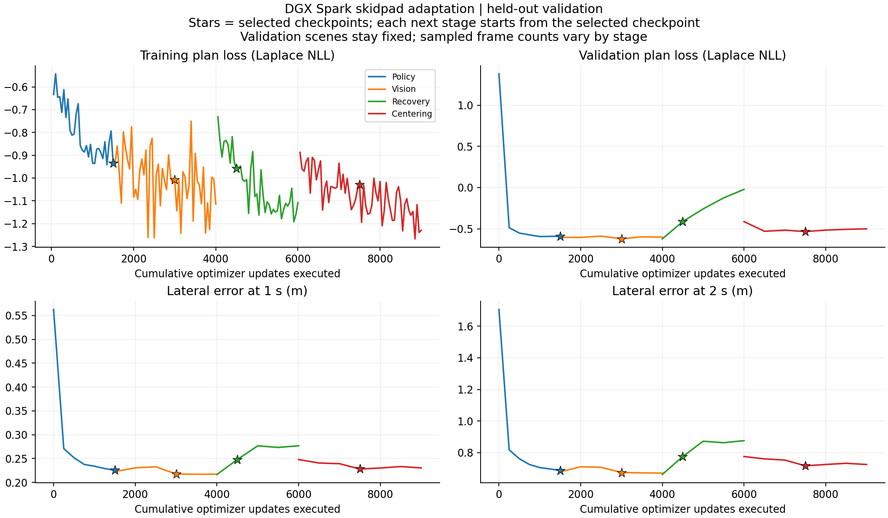
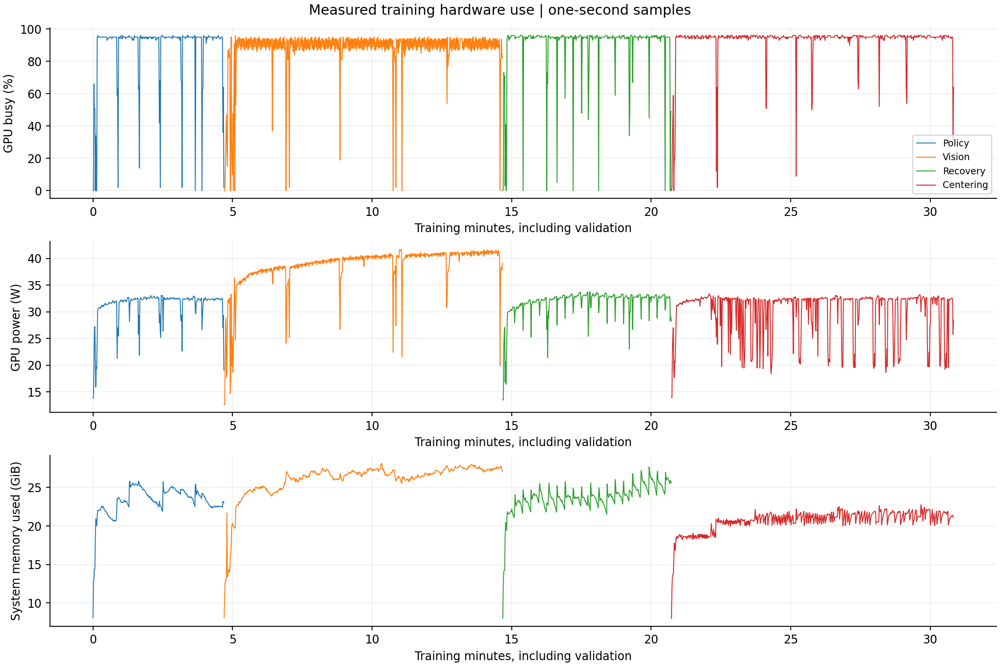
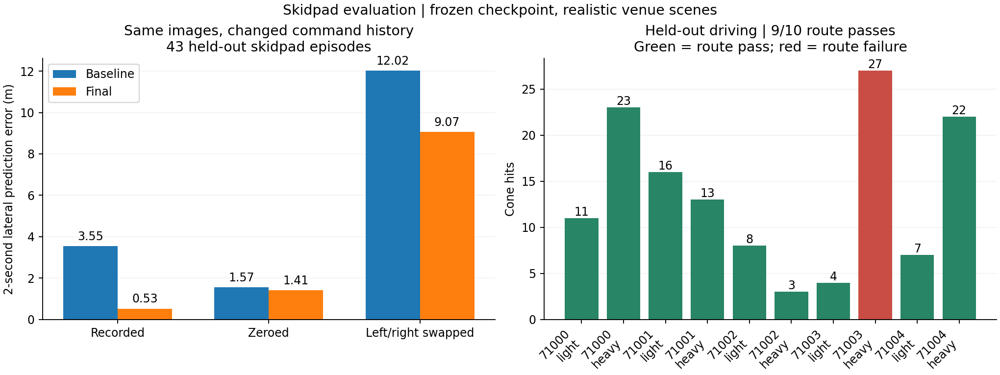

# Skidpad training on DGX Spark

The goal is a learned model that follows skidpad route commands, completes two right circles and two left circles, exits, and stops. This report separates command delivery, prediction accuracy, physical driving, and hardware throughput.

The selected model completes the required route on all six development scenes and nine of ten held-out venue scenes. It still hits cones and fails one heavily randomized scene. The selected checkpoint retains the full 31,154,802-parameter model. This is simulator support, not validation on a real vehicle.

## Held-out driving

The final checkpoint was frozen before this evaluation. Ten fixed evaluation scene variants use five scene seeds under light and heavy randomization. They are excluded from training and checkpoint selection. Baseline results on these scene identities were available during development, so this is not a previously unseen final test suite. The model follows its own predicted path through the unchanged pure-pursuit controller. There are no expert takeovers.

| Result | Measured value |
|---|---:|
| Required route, exit, and stop | 9/10 |
| Clean zero-cone passes | 0/10 |
| Cone hits, all runs | 134 total; 13.4 per run |
| Cone hits on successful runs | 3 to 23 |
| Off-course events | 2, both in the failed run |
| Mean timed lap result before penalties, successful runs | 10.29 s |

The failed scene is seed 71003 with heavy randomization. It completes the two right circles but not the two left circles, leaves the course twice, and ends as DNF. Mission progress reaches the end, but the independent physical referee rejects completion. This is why progress alone is insufficient for skidpad scoring.

The six-scene unchanged-weight baseline under the repaired code passed 0/6. The supplementary geometric audit of the original ten saved test traces found 0/10 valid routes. These are separate comparisons; the old ten-scene traces used the old command scheduler and lacked full vehicle state.

Trackdrive retention repeats the prior eight tracks with both randomization levels, seed 0, one lap, and a 120-second limit. Completion remains 15/16, and clean passes remain 7/16. Cone hits fall from 42 to 33; off-course events fall from six to four. This end-to-end comparison includes the shared standstill and timeout corrections introduced since the earlier run. It does not establish statistical improvement on all tracks.

## What was missing

The original policy already used route commands. With the same visual history on two original held-out skidpad episodes, mean two-second lateral error on command-active frames was 0.724 m with the recorded commands, 2.314 m with zero commands, and 6.273 m with left/right commands swapped. Twelve nonzero-command comparisons between the original FP32 ONNX policy and its PyTorch conversion had a maximum absolute plan difference of 0.00055.

The missing pieces were reliable command lifetime, repeated circle decisions, sufficient skidpad training, and physical route scoring. The previous dataset had 40 skidpad episodes with one right, one left, and one exit pulse per episode. Repeated calls to `observe` could consume a pulse. The original referee counted timing-line intersections without checking direction or circle order.

`RouteCommands` now emits isolated pulses for the upcoming junction, refreshes them every second during the approach, and handles both repeated circles separately. Observations return a copy of the command for that simulation frame. Recording pools four simulation ticks into each 5 Hz command sample. A behavioral test compares recorded and live command histories.

`SkidpadRoute` independently validates the observed physical trajectory. It requires directed gate crossings, full circle winding within the course corridor, the expected circle order, an exit into the stop zone, and a stationary dwell. It rejects reverse crossings, small loops, shortcuts, wrong circles, and unverified jumps. The pass result also requires zero off-course events. Cone penalties remain visible. The timed result averages the second right and second left laps.

The learned model still predicts the path from images and command history. The existing plan follower supplies control. Simulation progress supplies commands and mission braking. A real vehicle would need its own mission state, odometry, and lap counter. The simulator supplies these commands from privileged progress; this experiment does not show that the model can infer the required lap count from images alone.

## Live command dependence

The frozen model was driven in the same two scene variants at seed 71000. Correct commands passed both. Zeroed commands passed neither. Swapping left and right passed neither and sent the model around the left circle when the required first circle was right. These ablations change only the delivered command values; mission launch/braking and the follower remain unchanged.

| Delivered commands | Route passes | Observed failure |
|---|---:|---|
| Recorded mission commands | 2/2 | None |
| All zero | 0/2 | Incomplete circle in light; timeout in heavy |
| Left and right swapped | 0/2 | Wrong first circle in both |

A separate open-loop probe recomputes visual features from all 43 held-out skidpad episodes and holds each model's images and visual history fixed while changing commands. There are 7,222 command-active frames. The table weights episode errors by their active-frame counts.

| Checkpoint | Recorded commands | Zero commands | Left/right swapped |
|---|---:|---:|---:|
| Original full-recipe weights on the new data | 3.555 m | 1.565 m | 12.021 m |
| Final skidpad weights on the same data | 0.527 m | 1.409 m | 9.068 m |

Values are mean absolute lateral prediction error at two seconds. The original checkpoint uses commands, but the new pulse schedule and new data do not automatically improve its predictions. The earlier two-episode original-data probe used the old recorded schedule and is a separate comparison. For the final model, removing commands increases this error by 2.68 times; swapping left and right increases it by 17.22 times.

The model therefore uses the route input for branch selection. This does not establish perfect command obedience across all scenes or remove the need for a mission layer.

## Data and separation

The new dataset contains 320 skidpad episodes rendered in the realistic venue mode. Scene seeds are 80000 through 80319, with light and heavy randomization. Two thirds include disturbances and recovery excursions. All 320 complete the physical route and have recorded commands at all five junction decisions. Of these, 142 have no cone hits or off-course events.

The dataset also reuses 256 training and 32 validation trackdrive episodes from the previous full recipe. It never reuses the original trackdrive test split. The combined dataset has 608 episodes and 120,030 recorded frames. Every new camera frame was read and checked. New skidpad episodes split by episode identifier, which maps one-to-one to scene seed. Trackdrive keeps its original track-based split.

Live validation uses seeds 61000, 61001, and 61002 in both light and heavy randomization. The final live test is fixed to seeds 71000 through 71004 in both settings. The video scene was fixed to light randomization and seed 71000 before training. Final test scenes are excluded from checkpoint selection.

Initial recording and its audit took 261.74 seconds. A second audit added per-junction command coverage checks and took 24.77 seconds. Full feature caching took about 131 seconds. These costs are separate from optimizer training time. The orchestration record marker includes a deliberate review pause and must not be used as recording throughput.

## Experiments

| Experiment | Model updates | Outcome |
|---|---:|---|
| Original full checkpoint, repaired command and scoring code | 0 | 0/6 validation passes |
| Cached policy and BEV adaptation | 1,500 | 0/6 validation passes |
| Full vision adaptation | 2,500 | 0/6 validation passes |
| Same vision checkpoint, alternate follower | 0 | 0/6 validation passes |
| Policy adaptation with recovery data and refreshed features | 2,000 | 6/6 validation passes; 10.83 cones/run |
| Weighted replay with cleaner recovery states | 3,000 | 6/6 validation passes; 6.33 cones/run |

The original ten-scene baseline was also audited geometrically from its saved traces. None completed a valid physical route. Its old referee had reported one pass. Those traces omit lateral velocity and the final step, so the offline audit is supplementary evidence. The fresh six-scene code-only validation is the direct baseline for development.

Policy-only training retained all 31,154,802 model parameters and updated 7.8 million. Vision and image-detection tensors were checked bit-for-bit against the starting checkpoint after training. No state keys were lost, and all model parameters were finite. A regression test now prevents cached adaptation from silently discarding an existing image head.

That stage took 281.96 seconds including validation and saves. It sustained a median near 1,500 samples/s outside validation intervals. Mean GPU busy was 88.7%, peak allocated CUDA memory was 2.96 GiB, and mean system memory use was 23.24 GiB. GPU power averaged 31.33 W as reported by NVML, not wall-socket power.

GPU busy is not achieved FLOPs or memory bandwidth. The unused unified-memory capacity does not imply a training bottleneck. The original measured Spark optimizations remain enabled. They include constant-shape conversion, cached array handles, pinned transfers, fused AdamW, and cuDNN autotuning. Full-image training also uses channels-last tensors.

## Reproduction and artifacts

The Spark checkout is `/home/maxaitel/fs-openpilot`, mounted at `/workspace/fs-openpilot` in `fsop-spark-bench`. The data is `data/sim/spark_skidpad_intent`. Raw experiment results live in `runs/spark_skidpad`.

- `scripts/prepare_skidpad_training.py` records and audits demonstrations and replay splits.
- `scripts/probe_skidpad.py` measures command ablations, conversion parity, and live driving.
- `scripts/run_skidpad_training.py` runs cached policy adaptation and its validation.
- `scripts/run_skidpad_vision.py` runs full vision adaptation after policy validation.
- `scripts/plot_skidpad_training.py` exports loss, error, utilization, power, and memory graphs.
- `scripts/evaluate_skidpad_retention.py` repeats the original eight-track trackdrive suite.
- `scripts/render_skidpad.py` renders the predetermined skidpad video in a fresh process.

The decision trail is [skidpad-decisions.tsv](skidpad-decisions.tsv). The design comparison is [skidpad-design.md](skidpad-design.md). Sixty-two focused CPU tests passed on the Spark, with the unrelated venue-rendering test deselected. They cover route commands, physical scoring, recovery guards, replay sampling, checkpoint preservation, simulator behavior, and static-shape conversion. The static-shape suite also passed all 17 CPU/CUDA cases. Ruff passed over source, tests, and scripts. Independent review found and prompted fixes for image-head preservation and per-junction data coverage. The configured reviewers are from the same model family.

## Recovery experiment

Both existing followers completed four training-scene checks when fed expert plans. Direct expert control also passed all four. The pure-pursuit follower hit 0–4 cones, and the alternate follower hit none. The learned checkpoint failed with both followers. The next experiment therefore keeps pure pursuit and adds model-visited states.

The collector records the learner at 20 Hz, uses expert takeover with hysteresis when lateral or heading error grows, and labels every stored frame with a counterfactual expert rollout. It preserves live command and feature histories. Collection remains subject to the physical referee. The assistance is training-only.

Thirty-two distinct training scene seeds starting at 85000 produced 32 assisted route passes with zero off-course events. The model supplied 84.0% of controls on average. There were 6.56 interventions and 8.0 cone hits per episode on average. These are data-collection statistics, not autonomous model results. The training mix includes these 32 episodes, 32 original expert skidpad episodes and 64 trackdrive episodes. All original validation and test episodes are retained unchanged. The combined index contains 226 episodes and 45,973 frames. The 28 episodes after calibration took about 202 seconds, including setup. Refreshed feature caching took about 53 seconds.


## Final refinement and checkpoint selection

A second collection used the working recovery model with earlier expert takeover at 0.3 m lateral error or 0.12 rad heading error. Thirty-two new training scenes produced assisted route completions, zero off-course events, and three cone hits in total. The learner supplied 70.2% of the controls. These remain assisted collection results, not evaluation results.

The final mix contains all 608 original episodes plus 64 recovery episodes, for 672 episodes and 134,513 frames. The training split contains 574 episodes and 114,372 samples. Validation and test identifiers and their order remain unchanged. Training uses weighted sampling with replacement. The expected sample shares are 63.9% original replay, 9.6% first-round recovery, and 26.5% second-round recovery. Every original training frame remains eligible; each finite epoch does not guarantee visiting every frame.

The final cached stage took 607.37 seconds for 3,000 updates, including validation and saves. Its best validation-loss checkpoint was step 1,500. On six live validation scenes, it retained all six route passes and reduced total cone hits from 65 to 38. Both candidates had zero off-course events. This decided checkpoint selection before the final test.

The frozen checkpoint is `runs/spark_skidpad/final.pt`, with SHA-256 `ebd9824c19fd08bda4f07f9ec7f30af048b5a6e2278350df9eb80b837e60bb39`. It contains all 31,154,802 parameters, all finite. State keys are unchanged. Vision and image-detection tensors match the selected full-vision checkpoint bit-for-bit after cached adaptation.

The four experiments executed 9,000 optimizer updates. Their selected checkpoints were policy step 1,500, vision step 1,500, recovery step 500, and centering step 1,500. Each subsequent stage starts from its predecessor's selected checkpoint. The final lineage therefore contains 5,000 adaptation updates after the earlier full recipe, although 9,000 updates were executed and timed.

## Training time and hardware use

| Stage | Executed updates | Batch | Training time | Effective samples/s | Steady median samples/s | Mean GPU busy |
|---|---:|---:|---:|---:|---:|---:|
| Cached policy | 1,500 | 256 | 4m 42s | 1,362 | 1,501 | 88.7% |
| Full vision | 2,500 | 64 | 9m 59s | 267 | 296 | 87.4% |
| Recovery | 2,000 | 256 | 6m 3s | 1,412 | 1,498 | 90.1% |
| Centering | 3,000 | 256 | 10m 7s | 1,264 | 1,478 | 92.8% |

Total optimizer-run time was 30m 51s. This excludes data recording, feature caching, diagnostics, evaluation, and video rendering. Effective throughput includes validation and checkpoint saves. Steady throughput excludes the first logging interval and intervals containing validation. Different training stages have different work and data distributions, so their throughput is not a matched speedup comparison.

The full-vision stage updates the complete model and peaks at 8.97 GiB of allocated CUDA tensors. Cached stages update the policy and BEV head, preserve the frozen vision and image head, and peak at 2.96 GiB. Mean system memory use ranges from 20.7 to 26.0 GiB. Mean GPU-reported power ranges from 30.2 to 38.7 W. These measurements do not establish wall-socket efficiency or theoretical peak utilization.

The wider final replay mix has occasional slower data intervals than the compact recovery mix. Steady median throughput remains close to 1,500 samples/s. The Spark has ample unused memory, but increasing the full-image batch was already measured to reduce throughput in the earlier benchmark. The earlier 22.2% throughput improvement was measured in a single matched 200-step comparison. Run-to-run variability was not measured. Details are in [spark-performance.md](spark-performance.md).

## Reproduce the follow-up

Run from the repository root inside the prepared Spark container, after the earlier full recipe exists.

```bash
python scripts/probe_skidpad.py drive \
  --checkpoint runs/spark_full_refresh/ckpt/best.pt \
  --output runs/spark_skidpad/baseline_test --seeds 71000 71001 71002 71003 71004
python scripts/run_skidpad_training.py
python scripts/run_skidpad_vision.py
python scripts/collect_skidpad_recovery.py \
  --checkpoint runs/spark_skidpad_vision/ckpt/best.pt \
  --output data/sim/skidpad_recovery_r1 --count 4
```

Inspect the four assisted calibration episodes, then run `python scripts/run_skidpad_recovery.py`. Its collection phase resumes those episodes and completes the 32-scene first round.

Collect and inspect the first four second-round recovery episodes, then complete the same collection with `--count 32`. The configuration is fixed across both invocations.

```bash
python scripts/collect_skidpad_recovery.py \
  --checkpoint runs/spark_skidpad_recovery/ckpt/best.pt \
  --output data/sim/skidpad_recovery_r2 --start-seed 86000 \
  --count 4 --workers 8 --threshold 0.3 --heading-threshold 0.12 \
  --release-lat 0.12 --release-heading 0.08
python scripts/collect_skidpad_recovery.py \
  --checkpoint runs/spark_skidpad_recovery/ckpt/best.pt \
  --output data/sim/skidpad_recovery_r2 --start-seed 86000 \
  --count 32 --workers 8 --threshold 0.3 --heading-threshold 0.12 \
  --release-lat 0.12 --release-heading 0.08
python scripts/run_skidpad_centering.py
```

The pipeline scripts keep completion markers; use new run names and output directories for an independent rerun.

Copy the checkpoint selected on validation to `runs/spark_skidpad/final.pt`, then run the final evaluator. Its protocol file binds the test to the checkpoint hash.

```bash
python scripts/final_skidpad_evaluation.py --checkpoint runs/spark_skidpad/final.pt
python scripts/plot_skidpad_training.py --runs spark_skidpad_policy spark_skidpad_vision spark_skidpad_recovery spark_skidpad_centering
```

`scripts/summarize_skidpad.py` rebuilds the compact result record from these outputs and the saved checkpoint-audit and selection manifests. Those manifests record this run's manual checkpoint checks and validation-only choice.

The saved raw traces include commands, plans, controls, and vehicle states. The final evaluation uses no expert interventions. Video overlays show the learned path in magenta and the expert reference in green; the green reference does not control the car.


## Artifacts and review

The [machine-readable result](../benchmarks/performance/skidpad-2026-11-09.json) contains the checkpoint identity, selection rule, per-stage timings, hardware means, all final driving outcomes, and command-response measurements.







Raw JSON, compressed traces, telemetry, scalar exports, and PDF graphs are in `runs/spark_skidpad`. The full video is `artifacts/videos/spark-skidpad.mp4`. It is a 47.2-second H.264 clip at 1280×768 and 20 fps. The fresh rendered run completes all four circles, exits, and stops with 11 cone hits and zero off-course events. It uses the predetermined seed 71000 light scene. Its lap timings differ slightly from the saved evaluation trajectory; bitwise reproducibility across the separate render and evaluation processes was not established. The final model is `runs/spark_skidpad/final.pt`. These large files are gitignored and retained on the Spark and local workspace. The Spark also retains the generated datasets and intermediate checkpoints.

Independent code review found no further actionable issue after fixes for image-head retention, per-junction command coverage, and mismatched replay symlinks. The independent evidence review recomputed the checkpoint hash, driving totals, data separation, sampling order, throughput arithmetic, and command-ablation errors. It prompted explicit caveats about prior baseline exposure to the fixed test scenes and the single-run performance comparison. The configured review models are GPT-6.1 Terra and GPT-6 Astra. Both are from the same family, so this is not a cross-family review.

The work applied Fix Root Causes to command lifetime and physical scoring, Model the Domain to the junction scheduler and route validator, Prove It Works to held-out driving and command ablations, and Explain the Number to measured training time and GPU activity. The [decision trail](skidpad-decisions.tsv) records the experiments, rejected hypotheses, and checkpoint choice.
