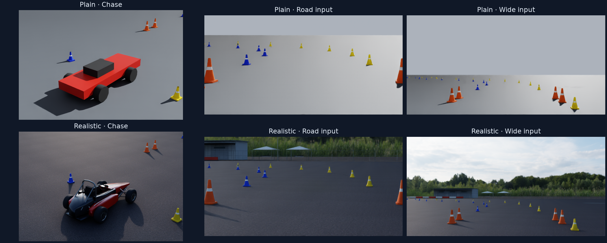
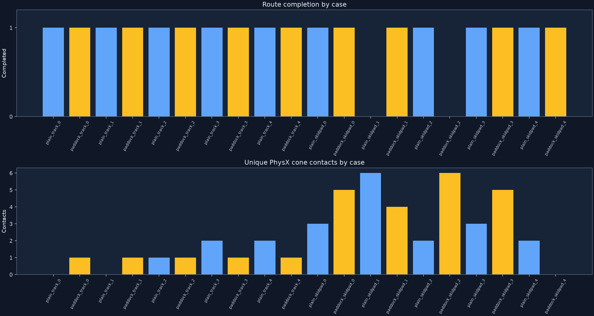
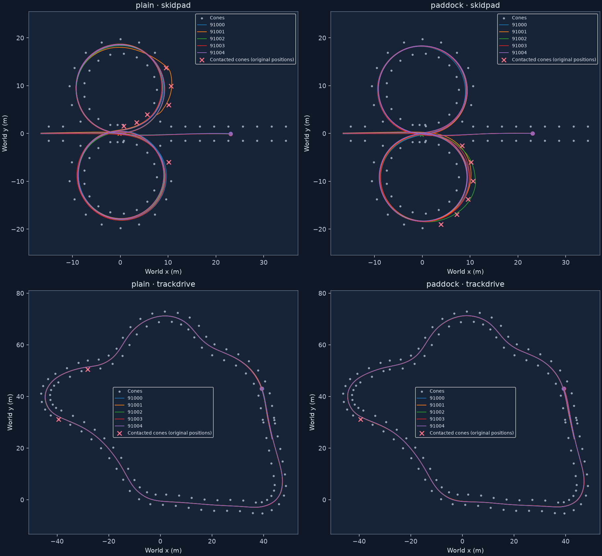
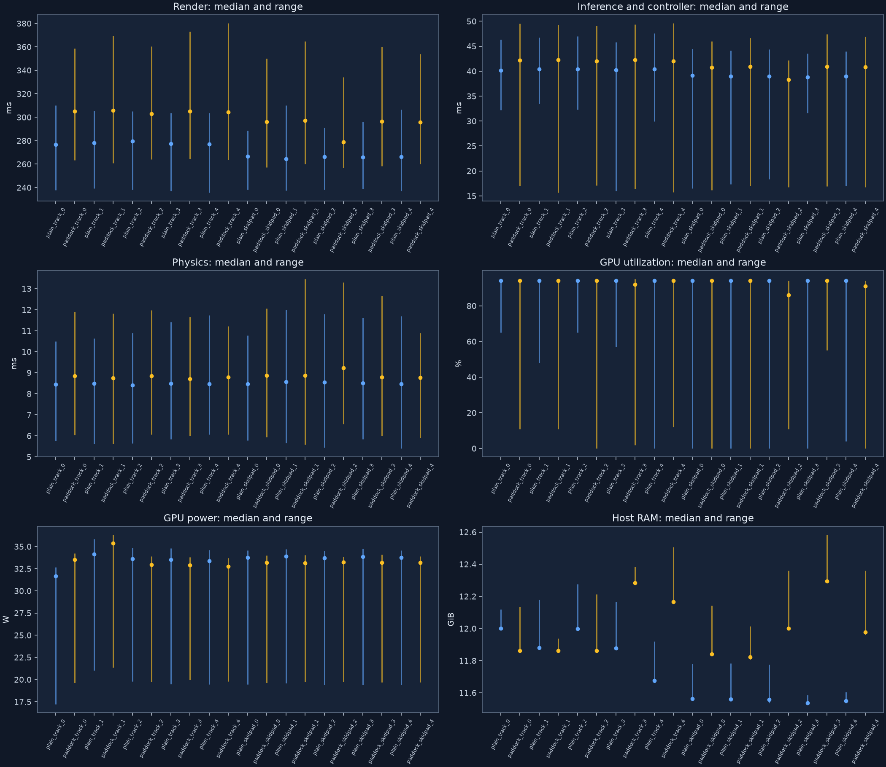

# Realistic-scene evaluation results

The goal was a more realistic scene to stress-test the existing frozen Formula Student model on the Spark. The new dry-day paddock uses scanned pavement, HDR daylight, detailed cones, original FS-style bodywork and an outdoor venue. Twenty paired trials are complete. The model completed most routes, but the realistic scene produced 25 cone contacts across ten attempts and only one contact-free completion.

## Outcomes

Five trials per scene/event used the same paired starts and physics. Seeds also vary scene-specific visual details. Completion below includes the existing route and safe-stop referee. Hits count unique cones with a PhysX contact per run, summed across the group.

| Scene | Event | Completed and stopped | Cone hits | Contact-free completions |
|---|---|---:|---:|---:|
| Plain | Cone track | 5/5 (100%) | 5 | 2/5 |
| Realistic paddock | Cone track | 5/5 (100%) | 5 | 0/5 |
| Plain | Skidpad | 4/5 (80%) | 16 | 0/5 |
| Realistic paddock | Skidpad | 4/5 (80%) | 20 | 1/5 |

The realistic track contacted cone `c0088` once in every trial. Realistic skidpad hits were `[5, 4, 6, 5, 0]` for seeds 91000 through 91004. Plain skidpad hits were `[3, 6, 2, 3, 2]`.

Both route failures are retained. Plain skidpad seed 91001 failed after three accepted laps at 43.55 simulated seconds, with six contacts. Realistic skidpad seed 91002 failed the first circle at 13.90 seconds, also with six contacts. Both were rejected as `incomplete_or_outside_circle`. The realistic failure struck outer-right blue cones `c0046` through `c0041`. Realistic seed 91004 completed all four laps, exited and stopped with zero hits. All episodes had zero sampled off-course events; that does not imply a valid skidpad route or collision-free driving.

These are two fixed layouts and five seeded trials each. Equal group completion rates conceal different failing seeds. The paired observations show appearance-sensitive behavior, but do not isolate individual causes such as lighting, pavement or starting pose.

## Spark performance

Hardware was NVIDIA GB10 on DGX Spark, with 20 CPU cores and about 121.7 GiB unified RAM. Runtime was ARM64 Isaac Sim 5.1.0-rc.19 with Torch 2.9.0+cu130. All cases used the same verified 16-subframe renderer, 120 Hz physics and 20 Hz simulated control rate.

The table shows the median across five runs. Frame-time columns are medians of each run's median frame time.

| Scene | Event | Real-time factor | Control ticks/wall second | Render ms/tick | Policy/controller ms/tick | Physics ms/tick |
|---|---|---:|---:|---:|---:|---:|
| Plain | Cone track | 0.153 | 3.05 | 277.3 | 40.4 | 8.5 |
| Realistic | Cone track | 0.139 | 2.78 | 305.1 | 42.2 | 8.8 |
| Plain | Skidpad | 0.157 | 3.14 | 266.2 | 39.0 | 8.5 |
| Realistic | Skidpad | 0.144 | 2.87 | 296.0 | 40.9 | 8.9 |

The twenty timed driving loops took **98.18 minutes** in total. Recorded startup added **3.97 minutes**. These sums exclude setup experiments, asset downloads, shutdown and report/video processing. Episode durations and paths differ, so these numbers do not isolate the causal cost of scene complexity.

Across realistic-scene telemetry samples, GPU utilization was median **94%**, device power median **33.18 W**, temperature median **65°C** and maximum **75°C**. Whole-host CPU utilization was median **17.9%**. Host RAM peaked at **12.58 GiB**, process RSS at **5.48 GiB**, and Torch peak allocation was about **0.137 GiB**. Unified host RAM is not dedicated GPU VRAM. Device and host telemetry include any other host services; samples are taken at 1 Hz.

Rendering accounted for **84.6%** of summed realistic loop time. After all simulator episodes had exited, 500 synchronized policy calls on fixed lossless calibration images took mean **5.96 ms**, median **5.95 ms**, and p95 **6.01 ms**, after 20 warmup calls. This includes preprocessing and the controller. It is an isolated latency fixture, not another driving score. The workload is render-limited; the memory capacity is not needed by this small inference workload. High GPU utilization alone does not prove optimal hardware efficiency.

Four and eight render subframes left old-pose ghosts and failed the unchanged camera-projection gate. An accumulation reset and DLSS Quality mode at four subframes also failed. Sixteen subframes passed. Lowering that setting for a faster headline would change image fidelity. The old four-subframe baseline is not a valid timing comparator for this experiment.

Torch emitted a nonfatal capability-range warning for GB10's CUDA capability 12.1. The installed runtime executed all episodes and the isolated benchmark. The prior same-input parity fixture against the original training runtime passed at tolerance 1e-4. No runtime, controller or weight tuning occurred during this scored suite.

## Evidence and replay

The measured executable source is commit `059b831`. Later comment cleanup and report/audit additions do not alter the recorded experiment. The checkpoint SHA-256 is `cf3a8d253dfd5a417e1967d2d6dc8cdd0263e3d16d3f1f02f15495f490a83b7e`. It has 31,154,802 parameters. Every episode verified the file and in-memory state before/after inference. The training repository and checkpoint were kept separate, with model files mounted read-only.

The protocol SHA-256 is `a234f237b5387ce824486a0457337e79c8263d3973bfd1eb11e19830161c65c4`. The report validates all ten pairs for protocol, track, start offsets, actual initial state, checked physics contract, checkpoint and model-state equality. The integration gate passed moving-camera projection below 1.5 pixels, zero-time capture, steering, braking, stability and positive/negative contact controls.

- [Aggregate measurements and pair integrity](realism_results/aggregate.json).
- [Integration verification](realism_results/integration_verification.json).
- [Model-only benchmark and raw timings](realism_results/model_only_benchmark.json).
- [Source audit](realism_results/frozen_source_audit.json).
- [Scene-bundle and video audit](realism_results/artifact_audit.json).
- [Reproduction guide](REALISM_RUN.md), [scene explanation and limitations](REALISM.md), and [decision trail](REALISM_DECISIONS.tsv).

Full artifacts remain in `isaac_eval/runs/realism_v1` in this worktree and on Spark at `/home/maxaitel/fsop-isaac-realistic/isaac_eval/runs/realism_v1`. `report.html` links every full H264 recording and contains the graphs and fixed-pose camera comparisons. `overview.mp4` includes every trial, every recorded contact window, and both route failures in full. Each passing case also includes its start and final 12 seconds. Videos play at simulation time and include three seconds holding the final status. Their labeled model-camera panels are lossy recordings of views that the policy received as unannotated RGB arrays.

Large videos and downloaded assets are kept outside Git. Each scene export includes its relative texture dependencies. The audit checks every delivered dependency hash, stage units/up-axis, contact cardinality, simulated-step accounting and full video frame count. The exporter uses hardlinks where possible; modifying a linked asset can affect multiple bundles, so recheck hashes after moving or editing them.

## Limits and review

This is a dry-day visual simulation experiment, not real-world safety validation. Ground-truth route-command pulses and mission-progress launch/finish braking remain supplied by the existing setup. The model does not independently infer lap count or route commands. The generic Ackermann vehicle retains a box chassis collider under tapered visual bodywork, so contact can occur outside the visible body. It is not a validated FS digital twin. Cameras have no measured ISP, sensor noise, rolling shutter or weather effects. Distant trees and sky are an HDR image; nearby venue props are visual only.

A fresh GPT-family review found no blocking defect in the inspected comparison. It prompted corrections to the historical reproduction instructions and seed description. The checked physical-contract guard is not a universal proof of all USD metadata invariants. Final bundle auditing separately checks units and up-axis. No different-family review model was available.
